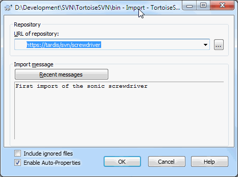

https://tortoisesvn.net/docs/nightly/TortoiseSVN_en/tsvn-quick-start.html

The Repository

Subversion uses a central database which contains all your version-controlled files with their complete history. This database is referred to as the repository. The repository normally lives on a file server running the Subversion server program

Working Copy

This is where you do the real work. Every developer has his own working copy, sometimes known as a sandbox, on his local PC. You can pull down the latest version from the repository, work on it locally without affecting anyone else, then when you are happy with the changes you made commit them back to the repository.

Creating a Repository

For a real project you will have a repository set up somewhere safe and a Subversion server to control it.

First create a new empty directory on your PC.  call it C:\svn_repos. Now right click on the new folder and from the context menu choose TortoiseSVN → Create Repository here.... 

create the default internal folder structure by clicking the Create folder structure button.

Importing a Project

Let's assume I have a set of files in C:\Projects\Widget1 that I would like to add. Navigate to the Widget1 folder in Explorer and right click on it. Now select TortoiseSVN → Import... which brings up a dialog

Figure 1.2. The Import dialog

A Subversion repository is referred to by URL, which allows us to specify a repository anywhere on the Internet. In this case we need to point to our own local repository which has a URL of file:///c:/svn_repos/trunk, and to which we add our own project name Widget1.

Checking out a Working Copy

The Subversion term for creating a fresh working copy is Checkout. Right click on  C:\Projects\Widget1 and select TortoiseSVN → Checkout.... Then enter the URL to checkout, in this case file:///c:/svn_repos/trunk/Widget1 and click on OK. Our development folder is then populated with files from the repository.

 let's update the repository. This action is referred to as a Commit of the changes. Right click on the Widget1-Dev folder and select TortoiseSVN → Commit. 

Unversion a working copy

https://tortoisesvn.net/unversion.html

