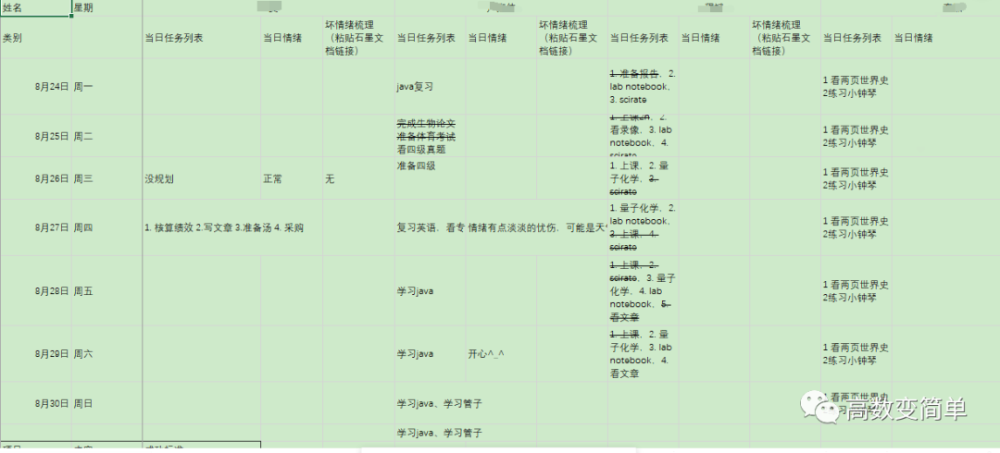

我打算重新开展这个互相激励促进学习进步的群组，具体就是每个组员可以把自己每天想要自律坚持做的，或者说是每天不能做的（要戒掉的坏习惯）自愿公开罗列下来，我们用电子表格的形式标记着每天是否有完成，大致就像这个表格里那样子，

每位成员都可以看到别的成员每天的完成情况——你看看我做了些什么，我看看你做了些什么，就这样彼此互相激励着前进，“要走得快那就一个人走，要走得远那就要和一群人走”，“蓬生麻中，不扶自直”！
虽说就是如此简单的一个事情，我以前也一直觉得没什么太大的意义，直到后来我参加了一个学社做了一段时间这种事情后才发现对自己其实有着很大的促进作用。
本着互利共进的目的，邀请能从学习或实践中获得乐趣的你加入我们的“共进学社”，入群后也许还能结交到一位好友！
入群考核：
请在留言区描述三点你在学习或实践中觉得不错的小成就（比如说那些过思考之后问出的有价值的问题、读书过程中产生的灵感、洞见等等），描述过程中最好有前因后果，末尾请附上你的邮箱或微信，审核通过的话我会联系你。如果觉得留言区写不下，也可以发邮件给我2281570025@qq.com