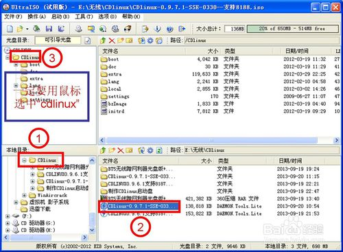
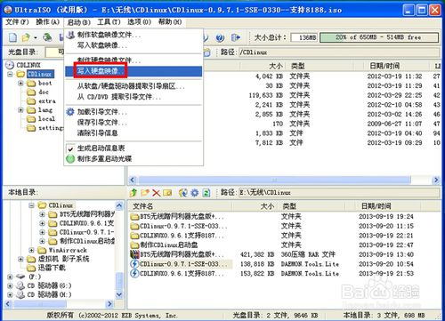
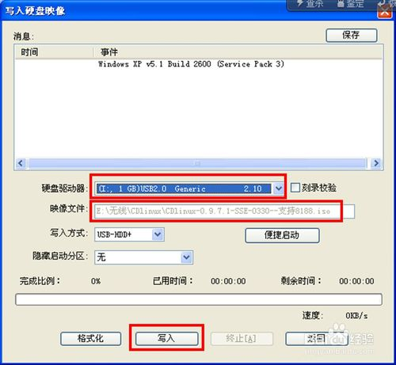
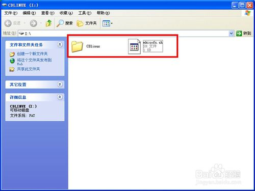

1. 【第一步】：用UltraISO把CDlinux的镜像刻录进U盘。

打开UltraISO，在左下角的“本地目录”找到CDlinux所在文件夹。

找到后缀为“.iso”镜像，双击进入镜像文件。

在左上角“光盘目录”中选中镜像中的“CDlinux”文件夹，【一定要选中】

2. 2在菜单栏点击“启动”--“写入硬盘映像”

3. 3“硬盘驱动器”选择你的U盘，这里一定要看清楚。

  然后检查“映像文件”的路径是否正确。

 写入方式默认是“HDD+”,这个不用更改，其它选项默认即可。最后点“写入”。

（如果你的U盘之前安装过像老毛桃这样的PE，要先选择“格式化”。记得备份u盘数据。）

 

4. 4一般等待一两分钟，就刻录完成了。刻录成功后，U盘的文件是这样的：

5. 5【第二步
