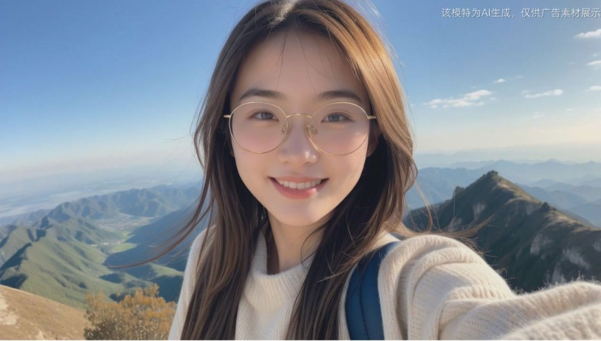

把伸手自拍的照片变成正常照片

下载去全球化，美团上叫淘宝，录音上架淘宝， T恤衫logo，
 Tts可以用来做广播剧，更粗放一点的话可以利用人工智能对文章里边的对话进行分析，分配角色赋予感情

租房避坑网站
极限定义，弥海砂
短信提醒

美女哥哥起床App，AI，360起床闹钟
林黛玉贾宝玉，文字转语音定制 tts定制

需要一个很好的收音装置和手机搭配，结合大模型让大模型创作人的第二大脑，这样才会比互联网对人有更好的影响。
或者我们应该在眼睛上搞一个非常好的收音方是充当人的第二父老让大模型来辅助人类作出判断和增加认识当前的情况。
比如说和朋友陌生人交流聊天之后做一番总结，进一步认识情况，这消大模型具有一定的洞察能力，洞悉人心。
甚至是用大模型来指导谈判作为更高智商的，有经验的，丰富的人来指导案例底下背后指导，远程指导，指导谈判。

我不想去上学，我不想去学校，我不想去上课，我只想自学。写一篇这样的文章，找一个出路

产品搜狗建议
自动化编程ydq,gpt,tv
淘宝文字材料
ai针对文本练口语，对话式，sumarize,辅导作业gpt anki例句
lex简历
cdian 警用 ai linux

小红书利润分成，慢慢开慢慢欣赏，

把排等于4和根号2=2的那个问题给讲清楚

 Cpe制作在淘宝上架，把闲鱼的搬到淘宝上去

文本转字幕的功能先识别出时间轴，然后再用文本大模型去校对，然后对于英文字幕的话，那个句子分割的话，就像我的那个数学讲座的第一季，以兔为分界点，
教会他怎么分聚之后呢，然后再根据每一个单词的起点时间和终点时间计算重新组合出完整的具有基本意思的部分，作为一条显示在屏幕上

然后又要用自己的视频测试一下YouTube的这方面的功能，对不对