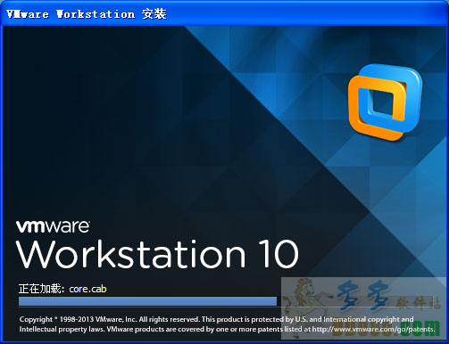
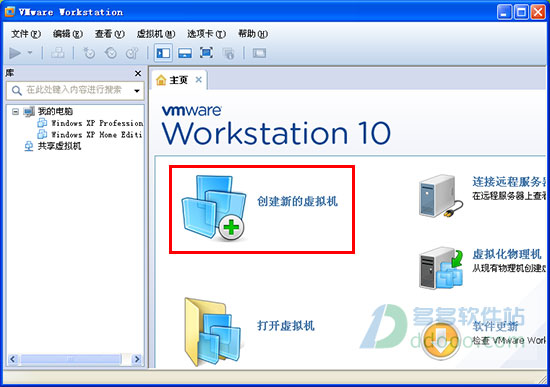
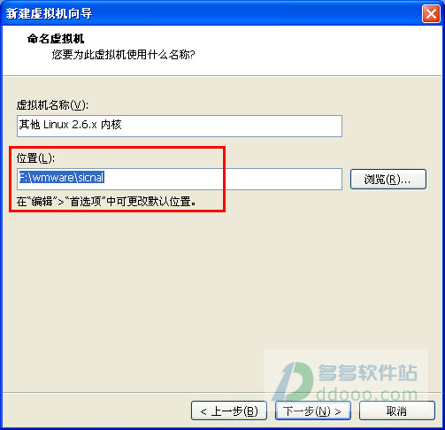
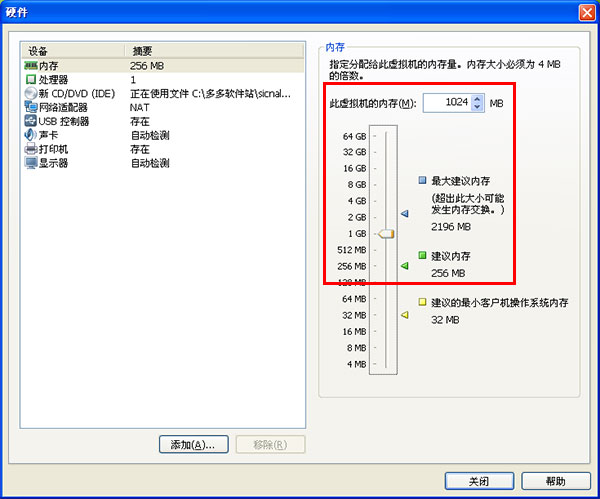
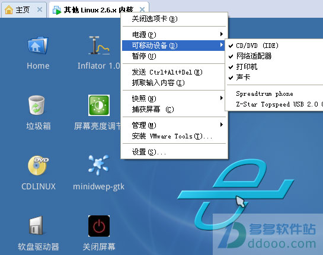
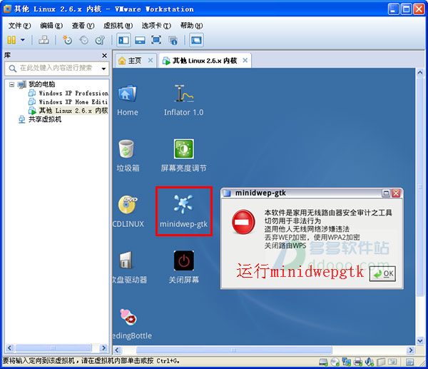
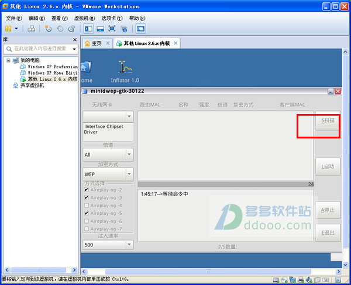
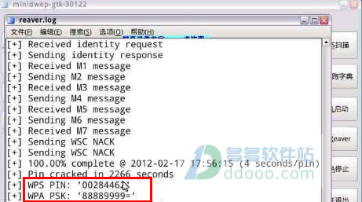

先下载安装虚拟机  
1、本站提供[vmware workstation 10虚拟机](http://www.ddooo.com/softdown/46138.htm)；  
  
2、使用虚拟机  
打开虚拟机后，点击“创建新的虚拟机”；  
  
选择典型；  
点击安装程序光盘映像文件，选择下载好的iso文件的sicnal软件；  
客户机选择“Linux”，版本选择“其他linux 2.6x内核”；  
位置随便设置，如 F:\wmware\sicnal；  
  
内存指定分配为1024M，运行速度会加快很多；  
  
启动虚拟机；  
加载无线网卡：虚拟机上面右击--可移动设备--找到你的无线网卡，对第一个“与主机断开或连接”进行点击一下；  
加载以后，你的网卡就会从主机里面跳到虚拟机里，这样才能继续下面的操作。  
  
二、运行minidwep gtk中文版破解无线密码  
1、点击小雨滴一样的图案；  
2、加载模式选择“wpa/wpa2”，再点扫描；  
  
3、扫描后，选择一个无线信号，点击“Reaver”按纽进行破解，  
4、接下载软件将自动运行；  
  
5、最后大约半小时，就会跳出得到的密码界面（根据实际情况，一般半小时-10小时肯定出密码）  
6、如图wps pin: 00284462就是他的pin，下面wpa pak:88889999就是密码，sicnal破解软件操作就是这样简单，希望对网友们有帮助。  
  
