双击文件名为“minidwep-gtk”程序：  

  

  
每次运行都会弹出一个提示窗口：  

[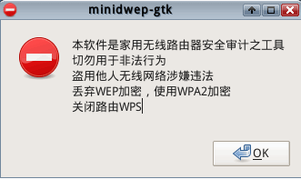](http://www.sztuoshi.com/zb_users/upload/2014/5/2014052883358001.png)  

  
  上面的说明，大家都懂的！切勿用于非法用户。。  
  下面详细介绍下该工具的主界面：  

[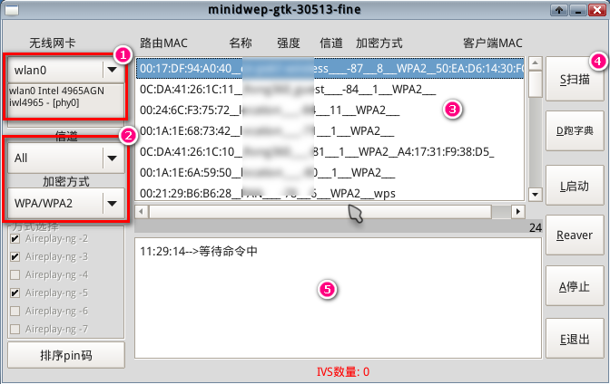](http://www.sztuoshi.com/zb_users/upload/2014/5/2014052883415033.png)  

  
  1）无线网卡 wlan0。这里显示自己的无线网卡信息。  
  2）信道，加密方式。信道就默认选All全部，加密方式分WEP、WPA/WPA2两种。下面的方式选择选择默认吧。  
  3）显示路由的mac地址、名称、强度、信道、加密方式等。  
  4）这一竖条都是功能按钮，点击实现相关功能。  
  5）这里扫描的时候相关状态进度显示。  
  
  看到界面之后，直接点上图4中的扫描按钮，就会看到中间的进度条再走了。  
  稍等片刻，就能看到路由的MAC、名称、强度、信道、加密方式等。  
  这里以加密方式为WPA/WPA2为例，WEP后面再说（因为更容易破）。  

[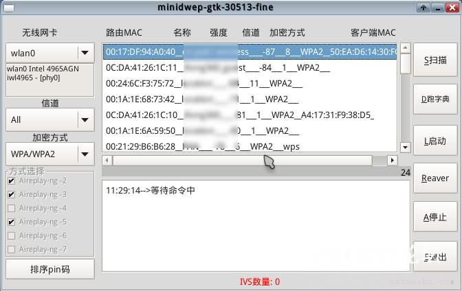](http://www.sztuoshi.com/zb_users/upload/2014/5/2014052883455625.jpg)  

  
  点击我们需要破解的路由名称，点右侧的启动，下放就会进行“握手”操作了，不停的与路由进行连接，这个过程是自动的，视路由及信号相关强度绝对时间的长短。  
  

[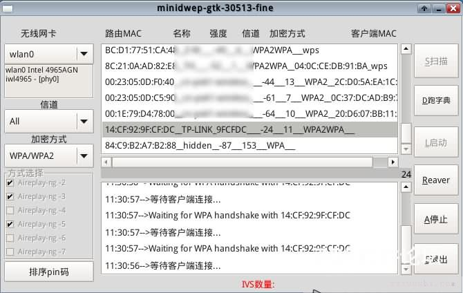](http://www.sztuoshi.com/zb_users/upload/2014/5/2014052883499969.jpg)

  当“握手”成功后，就会你相关提示，看到下图，就说明我们离成功更进一步了。  
  

[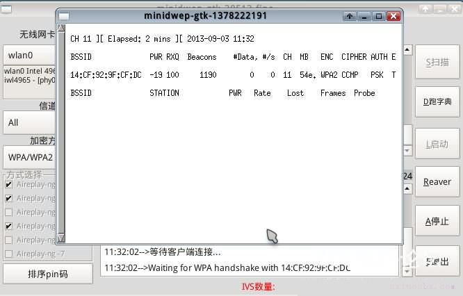](http://www.sztuoshi.com/zb_users/upload/2014/5/2014052883555505.jpg)  

  
  再稍等片刻，就会提示获取到握手包了。问我们是否选择一个字典来搜寻密码，点“Yes”之后再点“OK”。  
  

[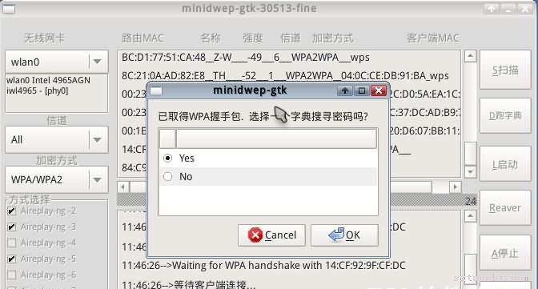](http://www.sztuoshi.com/zb_users/upload/2014/5/2014052883605841.jpg)  

  
  选择弹出窗口中的“wordlist.txt”这个是此镜像附带的，选中点击右下角“OK”。  
  

[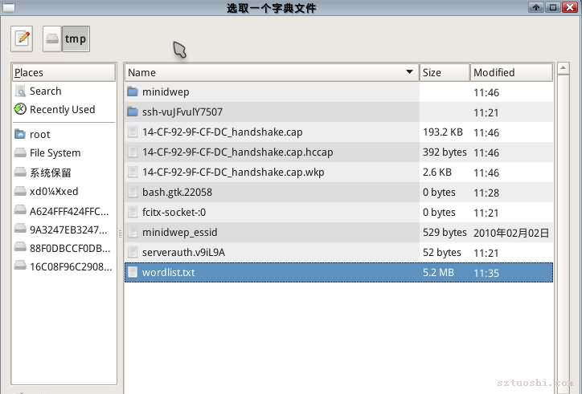](http://www.sztuoshi.com/zb_users/upload/2014/5/2014052883661609.jpg)  

  
  之后就是密码破解过程了，这个看运气和字典强度了。曾经有人分享给3G大小的密码包，按照这速度，一顿饭差不多能出结果了，如果不是特别BT的密码的话！  
  

[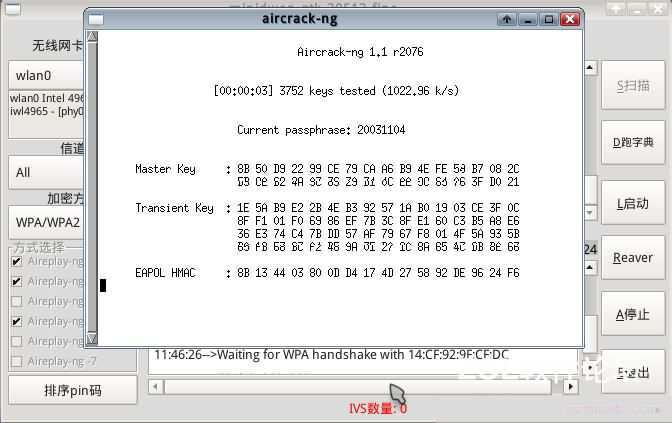](http://www.sztuoshi.com/zb_users/upload/2014/5/2014052883713473.jpg)  

  
  这次运气还算是比较好的，当软件自动扫描到密码后，会自动弹出的，这点真心赞一下！太人性化了！  
  弹出窗口显示详细的路由名称（SSID），密码信息。  
  

[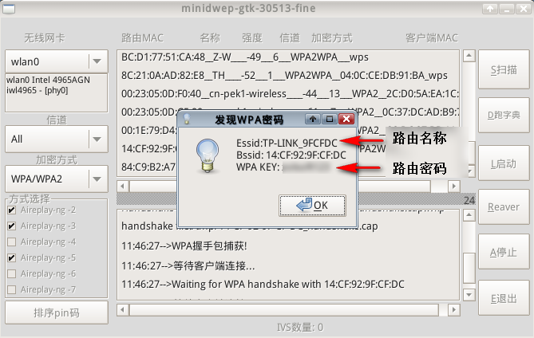](http://www.sztuoshi.com/zb_users/upload/2014/5/2014052883761505.png)  

  
  记录下破解出来的密码，然后软件会提示是否记录握手信息包到硬盘分区。  
  

[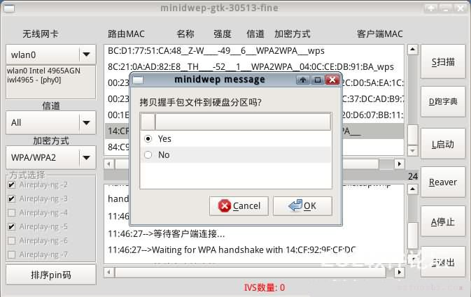](http://www.sztuoshi.com/zb_users/upload/2014/5/2014052883808529.jpg)  

  
  选择完保存路径之后就可以保存了。  
  

[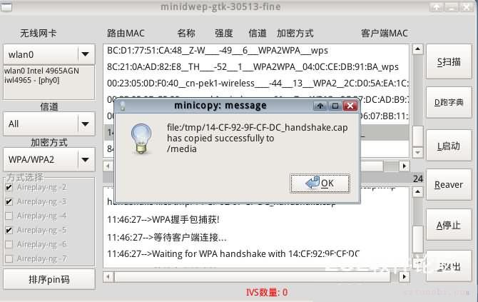](http://www.sztuoshi.com/zb_users/upload/2014/5/2014052883856593.jpg)  

  
  这样一个[路由](http://www.sztuoshi.com/tags-64.html "路由器")的密码就算是破解出来了。看似简单的一篇图文详细教程，也废了流云好大力气，CDlinux U盘启动用了很多种方法，格式化数次U盘才选中这一种曲线救国而又异常方便的方法，希望大家也能成功破解出自己希望破解的路由密码！WiFi密码破解详细图文教程也就到这里了，希望能看明白吧！后续有什么新东西也会不定期更新在这个帖子里，没事多来看看哈，说不定有什么惊喜呢！

  
