启动 ewsa 并设置为中文

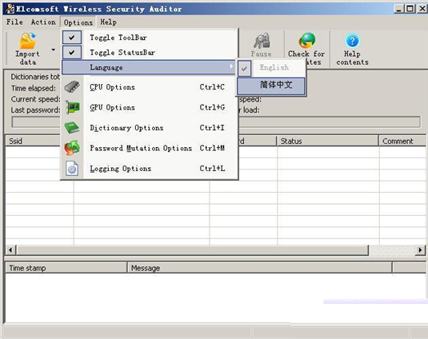 

点导入数据→导入 AP 目标数据文件

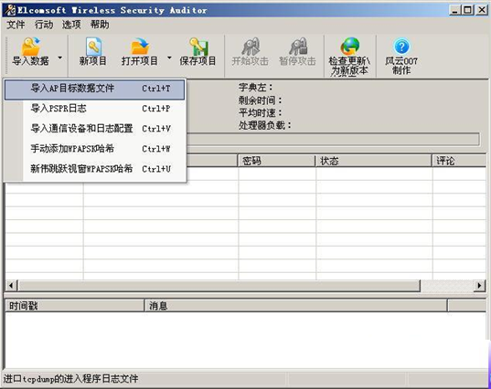 

选择刚才 U 盘里面拷贝出来的“握手包”点打开。

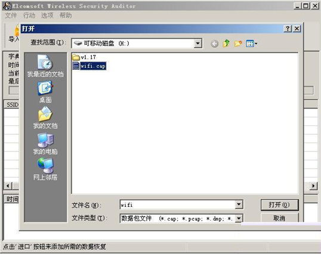 

打开后“握手包”再点 OK

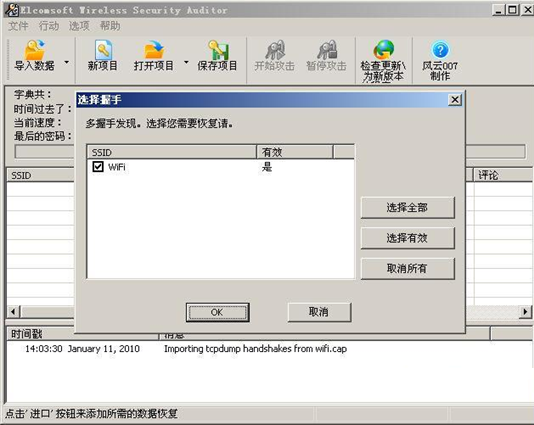点选项→新建字典选项

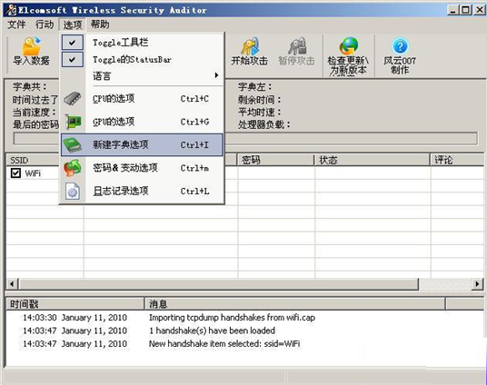 

 

添加一部字典也可以是多部字典后点 OK

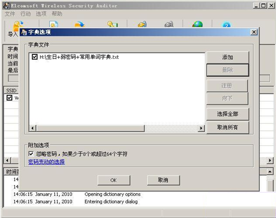 

选择要暴力破解的“握手包”并点开始攻击

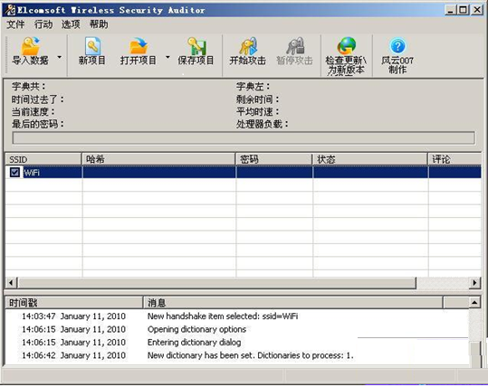  

正在暴力破解中………………..

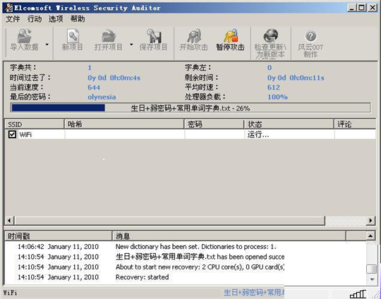 

密码出来了……………..呵呵！

我的破电脑显卡不被软件支持只是纯 CPU 跑的速度已经很快了，如果是 4 核 CPU 加一块好

显卡每秒跑字典的速度可以达到一万以上。

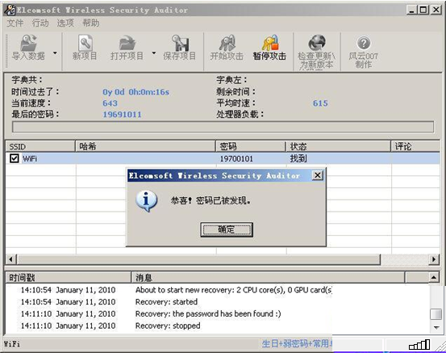 

Elcomsoft Wireless Security Auditor

ElcomSoft  是一家俄罗斯软件公司，出品过不少密码破解软件，涉及  Office、SQL、PDF、

EFS 等等。近日 ElcomSoft 又推出了“Wireless Security Auditor ”，号称可以利用 GPU 的运算

性能快速攻破无线网络密码，运算速度相比使用 CPU 可提高最多上百倍。本软件的工作方

式很简单，就是利用词典去暴力破解无线 AP 上的 WPA 和WPA2 密码，还支持字母大小写、

数字替代、符号顺序变换、缩写、元音替换等 12 种变量设定，在 ATI 和 NVIDIA 显卡上均

可使用。

它还通过尝试恢复对  WiFi  通信进行加密的  WPA/WPA2 PSK  初始密码来帮助系统管理员

实现对无线网络安全的监控。通过运用由两大显卡制造商 ATI  和  NVIDIA  提供的硬件加

速技术，Elcomsoft  Wireless  Security  Auditor  已逐渐成为市场上最快速且最具成本效益的

WiFi  密码恢复和无线安全监控工具之一。

 

说通俗点就是用 EWSA 加载“握手包”并通过电脑的 CPU和 GPU 来跑字典快速完成暴力破解

 

四、破解 WPA 加密“握手包”字典的制作

 

根据上面的实战大家可以看出  WPA  的加密只要有合理的字典一样可以很快就破掉

的， 所以我们只要根据中国人特点生成有针对性的字典就可以了！

 

1、一般有常用的弱密码如  1234567890  和常用的英文单词

2、生日密码也是大家用的最多的密码

3、在就是手机号和座机号码做密码（根据当地电话号码段生成）

手机号码段查询：http://mobile.tool.la/sheng/

 

 

给大家提供 3 个好用的字典生成工具

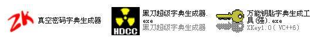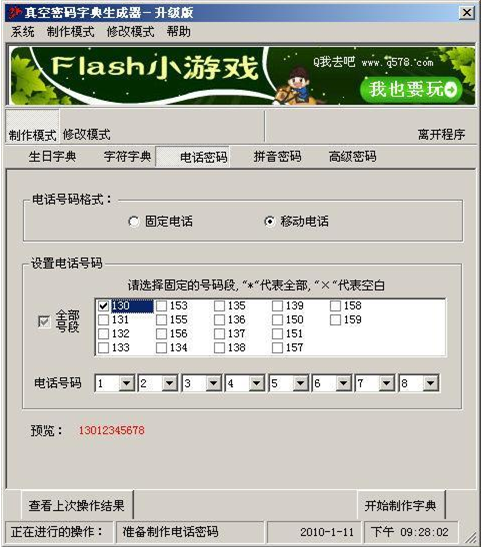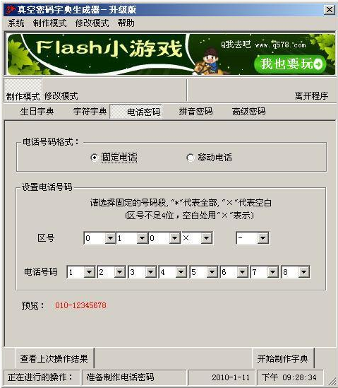  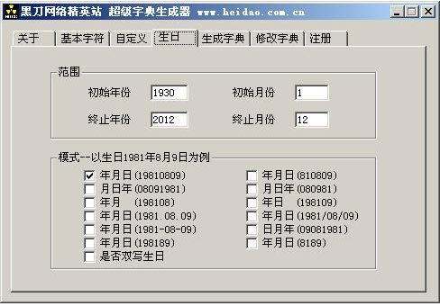  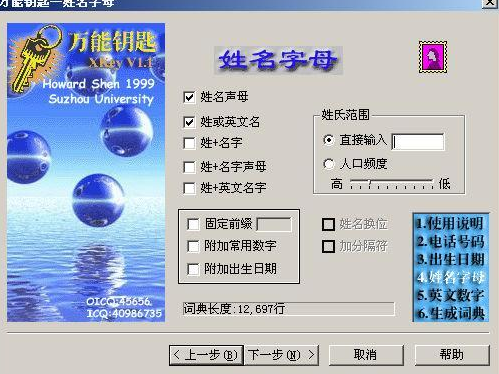   
