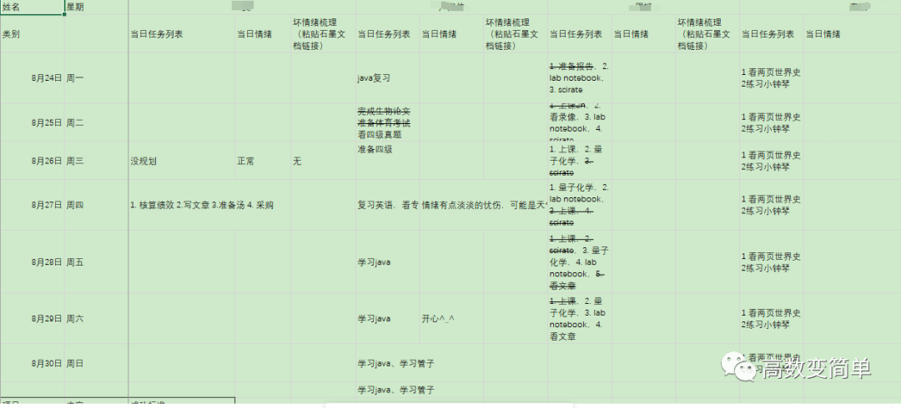

我打算组建一个互相激励促进学习的群组，具体就是每个组员把自己每天要做的，或者说是要每天不能做的（要戒掉的坏习惯）自愿公开罗列下来，我们用电子表格的形式标记着每天是否有完成，大致就像这个表格里那样子，

每位成员都可以看到别的成员每天的完成情况——你看看我做了些什么，我看看你做了些什么，就这样彼此互相激励着前进，“要走得快那就一个人走，要走得远那就要和一群人走”，“蓬生麻中，不扶自直”。
虽说就是如此简单的一个事情，我以前也一直觉得没什么太大的意义，直到后来我参加了一个学社做了一段时间这种事情后才发现对自己其实有着很大的促进作用。
本着互利共进的目的，邀请能从学习中获得乐趣的你加入我们的“共进学社”，没有专业限制，我们主要做的事情就是上面描述的这个，群内不负责帮人解题，也不一定会回答伸手党的问题，只有经过思考或努力探索而未得解的问题才会有人回答你，我们希望加进来的是有一定学习独立性的人。没准入群后还能结交到一位好友~！
入群考核：
请描述三点你在学习上觉得自己不错的小成就（比如说那些过思考之后问出的有价值的问题、读书过程中产生的灵感、洞见等等），描述中最好有前因后果，然后发送到mathjoy@wo.cn，合格的话我会把邀请加群的二维码通过邮箱发给你。