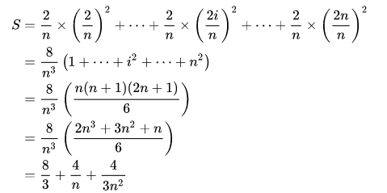

以等号处转行就在前面加\\

以等号对齐就在前面加&

$$

{\displaystyle {\begin{aligned}S&={\frac {2}{n}}\times \left({\frac {2}{n}}\right)^{2}+\cdots +{\frac {2}{n}}\times \left({\frac {2i}{n}}\right)^{2}+\cdots +{\frac {2}{n}}\times \left({\frac {2n}{n}}\right)^{2}\\&={\frac {8}{n^{3}}}\left(1+\cdots +i^{2}+\cdots +n^{2}\right)\\&={\frac {8}{n^{3}}}\left({\frac {n(n+1)(2n+1)}{6}}\right)\\&={\frac {8}{n^{3}}}\left({\frac {2n^{3}+3n^{2}+n}{6}}\right)\\&={\frac {8}{3}}+{\frac {4}{n}}+{\frac {4}{3n^{2}}}\end{aligned}}}

$$