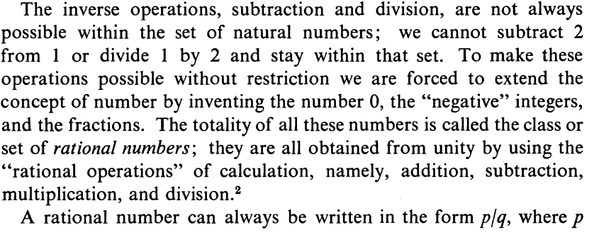
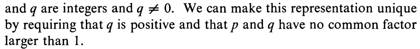
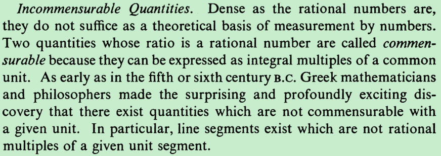
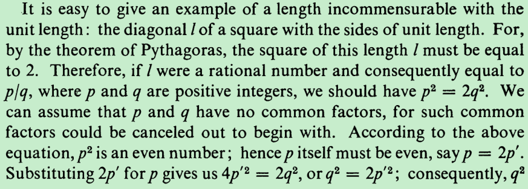
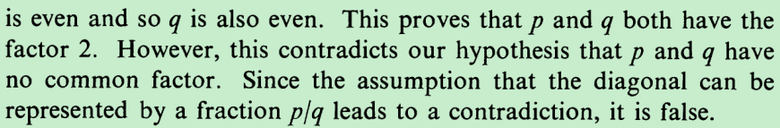
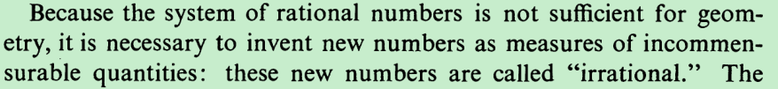

不是数轴是连续的

Two quantities whose ratio  is  a rational number are called  commen-

surable  because they can be expressed as integral multiples  of  a common

unit.  As  early as in the fifth or sixth century  B.C.  Greek mathematicians

and philosophers made the surprising and profoundly exciting dis-

covery that there exist quantities which are not commensurable with

a given unit.

Because the system  of  rational numbers  is  not sufficient for geom-

etry, it  is  necessary to invent new numbers as measures  of  incommen-

surable quantities: these new numbers are called "irrational." 

That the system  of  real numbers

(as symbols for the lengths  of  segments, or otherwise defined)  is  a

consistent and complete instrument for scientific measurement

一一对应、双射、满射  什么的

举一反三、困于心衡于虑

