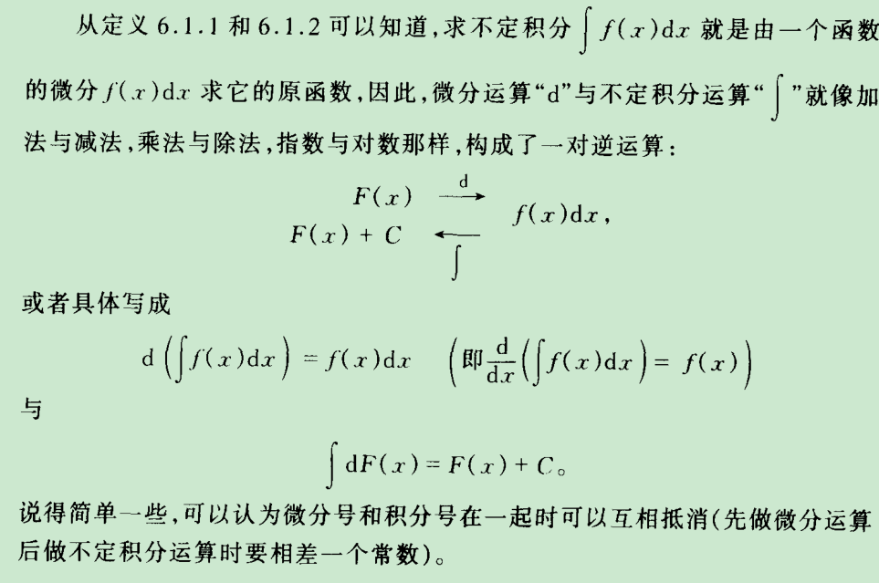
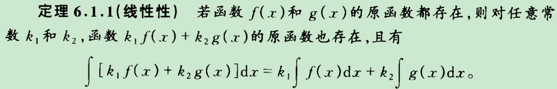
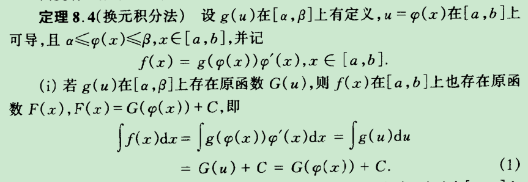
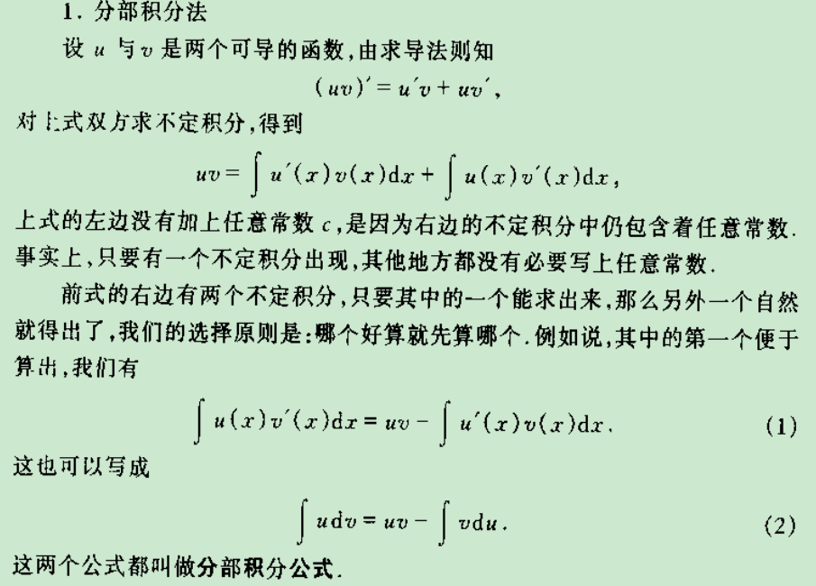
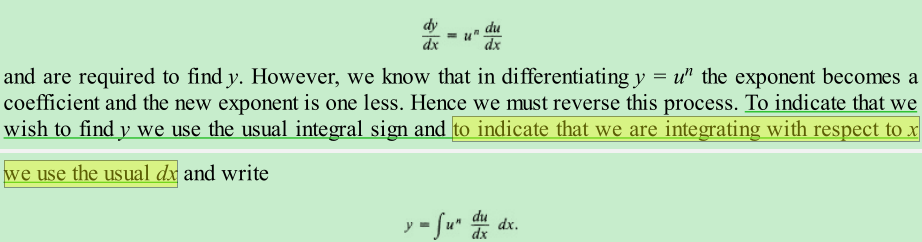
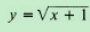
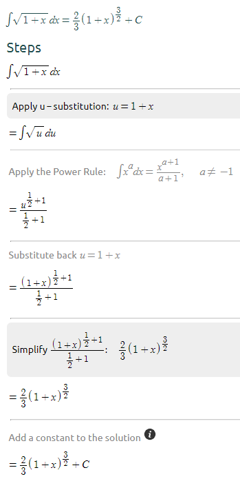
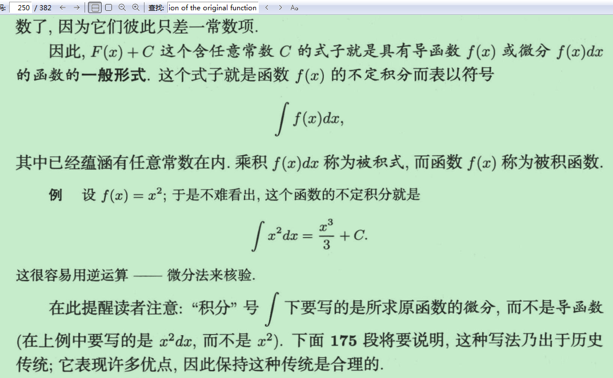
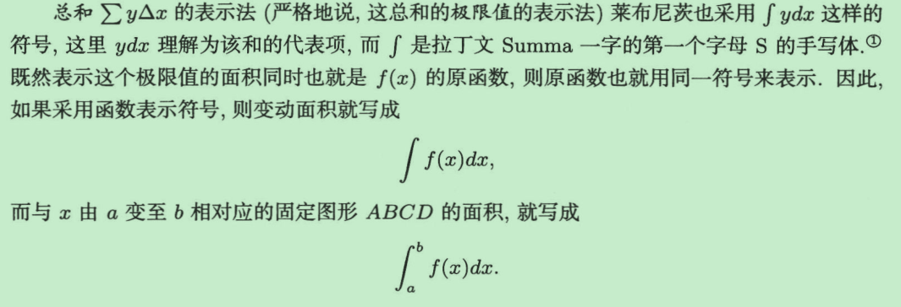

华东pdf 182

---

按照这种说法，

那么

对x+1和x的原函数就不同了，

下面是对x的结果（其中的替换有待进一步弄清原理）https://www.symbolab.com/solver/step-by-step/integral%20sqrt%5Cleft(1%20%2B%20x%5Cright)%20dx

---

乍看之下dx不是必要的，甚至是用另外的符号P（f(x)）就可以代替，但是

还没有看到有点是什么？待探究，也许科朗的方法才对

