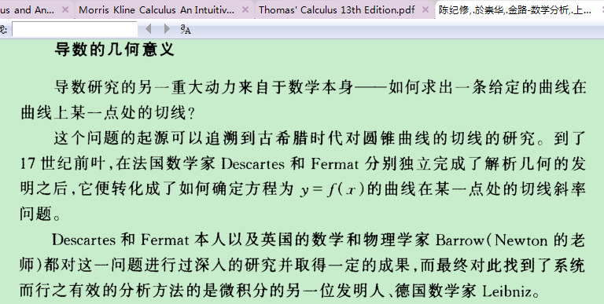
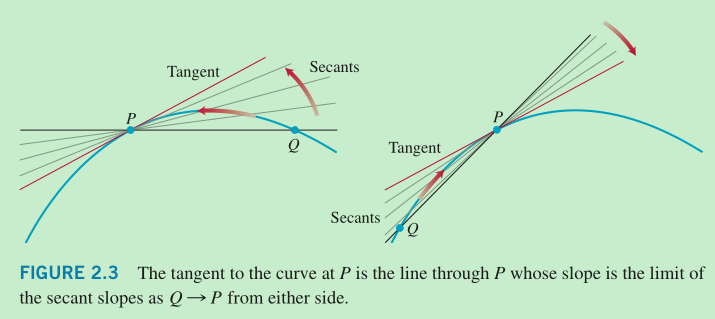
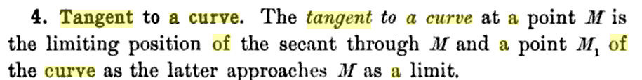
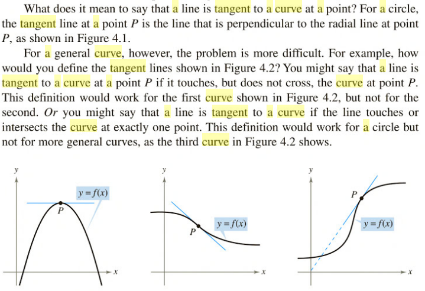

首先的问题是如何定义这种情况下的切线，明确定义之后再做

4 Tangent to a curve The tangent to a curve at a point M is the limiting position of the secant through M and a point M1 of the curve as the latter approaches M as a limit 

https://books.google.com/books?id=hkENAAAAYAAJ&dq=tangent%20of%20a%20curve&hl=zh-CN&pg=PA6#v=onepage&q=tangent%20of%20a%20curve&f=true

https://books.google.com/books?id=IBjvMZSIsCYC&lpg=PA262&dq=tangent%20of%20a%20curve&hl=zh-CN&pg=PA262#v=onepage&q=tangent%20of%20a%20curve&f=true

