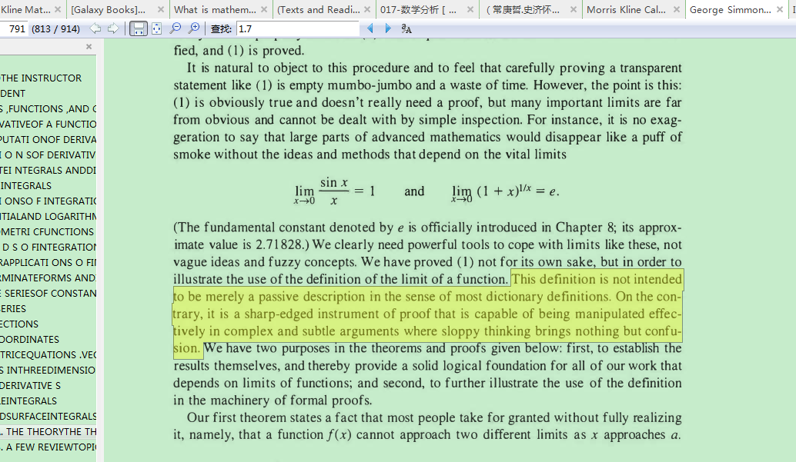

Hard to understand the (ε, δ)-definition of limit（如何理解极限定义）？

If you found the definition doesn’t not accord with your intuitive idea , I must tell you that YOU ARE RIGHT , please see

What is mathematics - R. Courant & H. Robbins

Chapter VI,

§2(LIMITS) ~ §4(PRECISE DEFINITION OF CONTINUITY)

to understand more.

 

 

 

 

 

define the sum and product of two positive infinite decimals

 

What is mathematics - R. Courant & H. Robbins

Chapter VI,

2. Monotone Sequences

