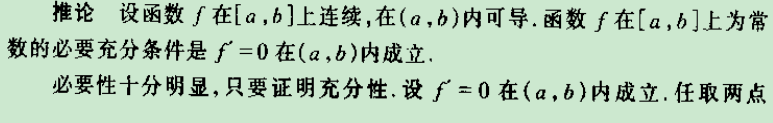
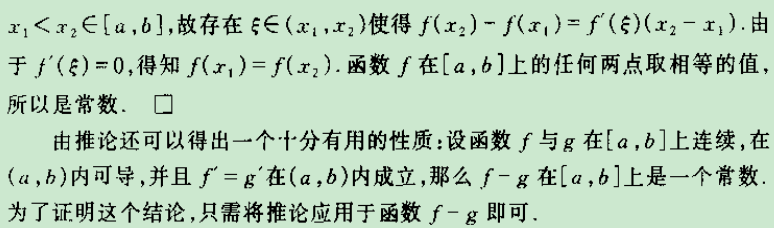
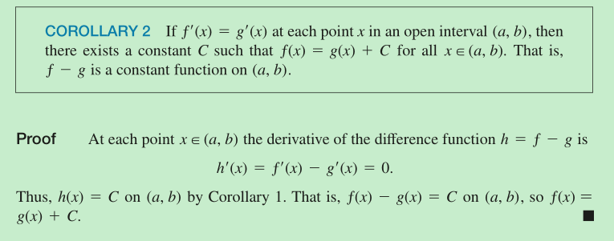
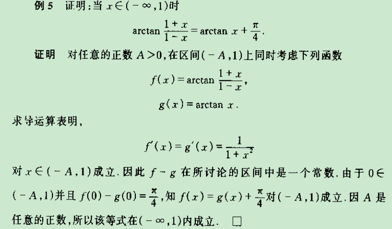

证明的话：如果是常数函数，那么根据导数表达式定义就可以得出导数都是0；如果导数都是0，那么反证法假设有不为0的点，那么函数在该点处不增就减，以至于不是常数函数，所以导数都是0就是常数函数。

---

微分中值定理的证明方法

---

两个原函数的差

这个证明过程中直接应用上面的结论而不是从头开始推倒起，值得学习

---

巧妙的练习题：

由于不太熟悉arctan的运算，所以不能从运算这个角度出发。改为左边两个arctan相减，右边是一个常数的情况，可以利用微分中值定理（这就要熟悉arctan的求导了，再不熟悉就完蛋了）求证左边是一个常数函数（可以直接应用上面的结论走捷径），然后寻找能定常数c的x值！

