史济怀P149

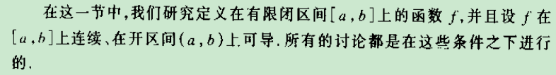

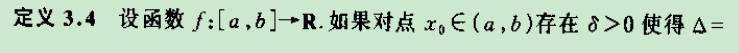

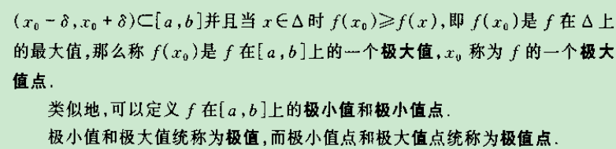

比一个领域内的值都大（或等于）则改点的值是极大值点

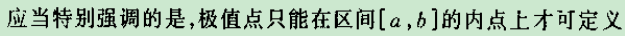

极值点是建立在开区间内的，这样在极值点导数才会等于0的情况，如果将极值点扩展到开区间的话，将可能存在极值点导数不等于0的情况，而后面谈论建立在

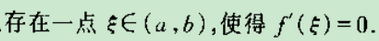

这会使得后面谈论的定理不具有普遍意义；

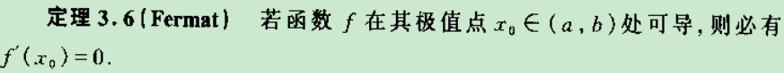

是必要的，反例y=-|x|，x=0处的导数

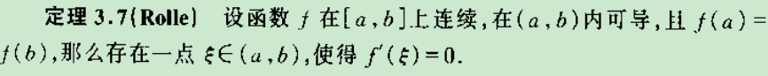

m<=f(x)<=M, 如果m=M,那么m=f(x)=M，也就是f(x)是一个常数函数

闭区间连续——保证最大值或最小值至少有其一在开区间取得，这时这个最大值或最小值也是一个极值点

开区间可导——极值点是建立在开区间内的，以至于才会使得在极值点的导数等于0

而后面的定理都建立于Rolle之上

满足条件的函数不单调或是常数函数

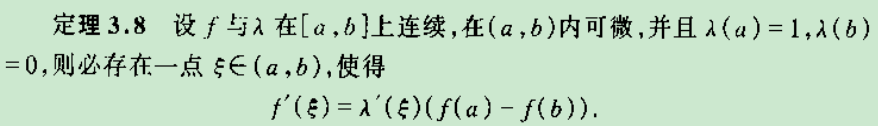

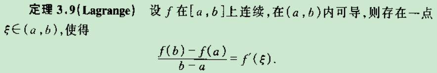

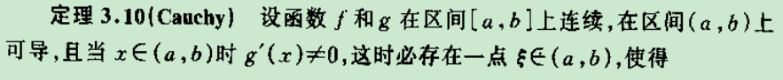

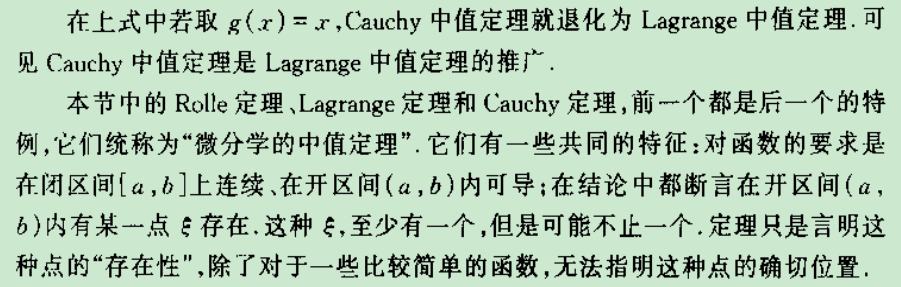

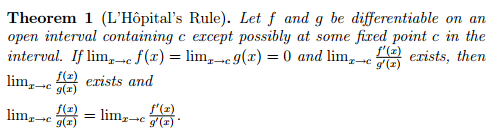

math.stackexchange.com/questions/1443006/question-about-proof-of-l-hôpital-s-rule

证明请看开篇：数学分析新讲2.张筑生.djvu

使用条件：

1.在关于a的空心领域内两个函数都可导

2.

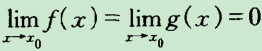

3.如果

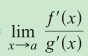

存在

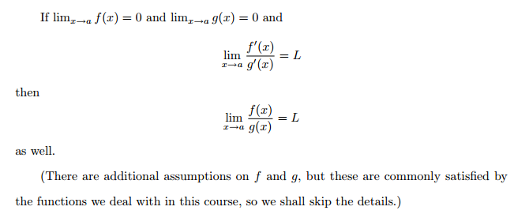

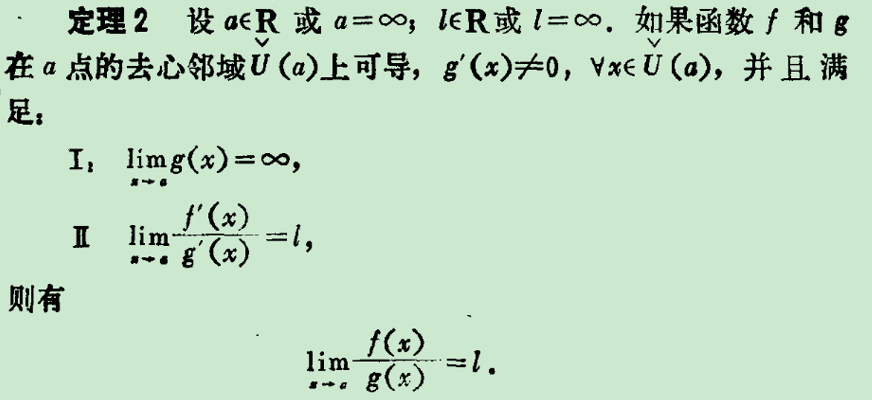

使用条件：

1.在关于a的空心领域内两个函数都可导

2.

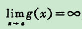

3.如果

存在

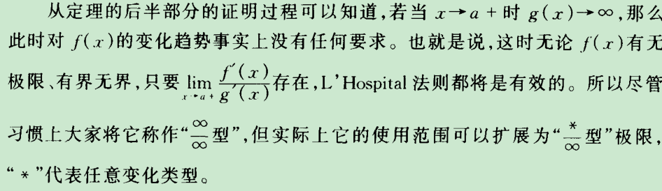

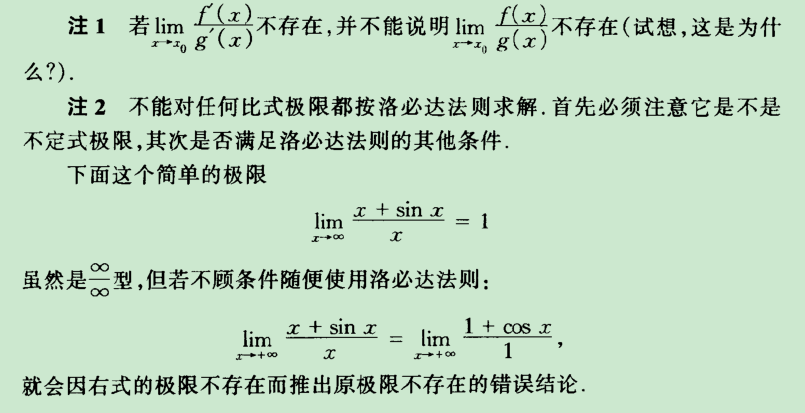

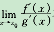

存在是使用罗比达法则的前提之一，并不是决定极限存在的因素。

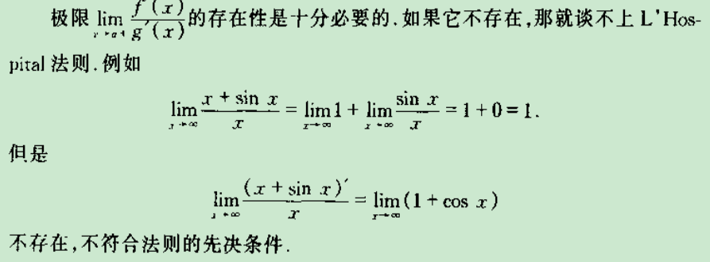

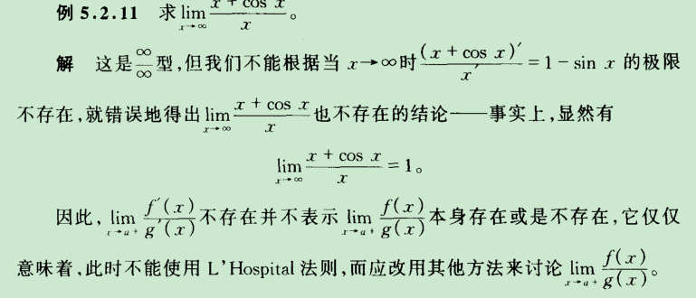

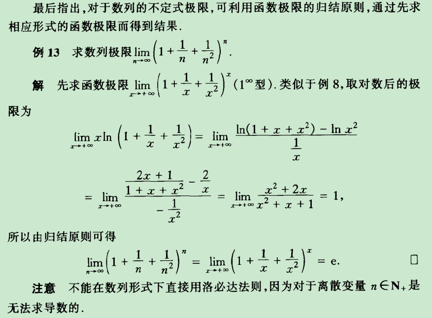

计算技巧

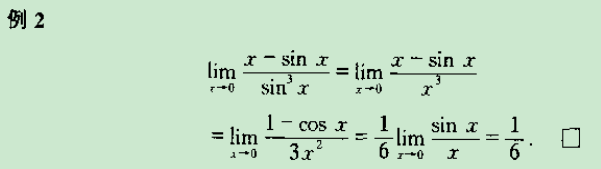

