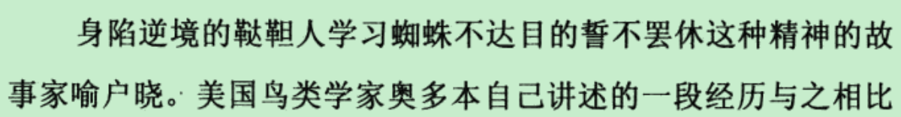

为什么会出现两个不同的数符表示同一个数

https://en.wikipedia.org/wiki/0.999...

defining the infinite decimal representation of real numbers in terms of nested sequences of intervals.

Every nonzero, terminating decimal (with infinitely many trailing 0s) has an equal twin representation with infinitely many trailing 9s (for example, 8.32 and 8.31999…). The terminating decimal representation is usually preferred, contributing to the misconception that it is the only representation. The same phenomenon occurs in all other bases (with a given base's largest digit) or in any similar representation of the real numbers.

The equality of 0.999… and 1 is closely related to the absence of nonzero infinitesimals in the real number system.

these proofs are not rigorous as they do not include a careful analytic definition of 0.999….

when a large number of 9s is taken, the difference between 1 and .99999… becomes inconceivably small"

the sum of a series is defined to be the limit of the sequence of its partial sums.

the real numbers are constructed by defining a number using an integer followed by a radix point and an infinite sequence written out as a string to represent the fractional part of any given real number. In this construction, the set of any combination of an integer and digits after the decimal point (or radix point in non-base 10 systems) is the set of real numbers.

every nonzero number with a finite decimal notation (equivalently, endless trailing 0s) has a counterpart with trailing 9s.

In general, any terminating base b expression has a counterpart with repeated trailing digits equal to b − 1. 

Students are often "mentally committed to the notion that a number can be represented in one and only one way by a decimal." Seeing two manifestly different decimals representing the same number appears to be a paradox, which is amplified by the appearance of the seemingly well-understood number 1.

When asked about 0.999…, novices often believe there should be a "final 9," believing 1 − 0.999… to be a positive number which they write as "0.000…1". Whether or not that makes sense, the intuitive goal is clear: adding a 1 to the final 9 in 0.999… would carry all the 9s into 0s and leave a 1 in the ones place. Among other reasons, this idea fails because there is no "final 9" in 0.999….

国富论

Non-uniqueness of decimal representation and notational conventions

https://en.wikipedia.org/wiki/Decimal_representation

这和康托的证明有理数级比实数级要小的那个理论那里有一些限制结合在一起说一下

