任何两个无理数之间还有有理数吗

construction of real numbers using Dedekind 

What is the continuum? On the face of it, there are several distinct forms of the continuum as a mathematical concept: in geometry, as a straight line, in analysis as the real number system (characterized in one of several ways), and in set theory as the power set of the natural numbers and, alternatively, as the set of all infinite sequences of zeros and ones.

http://www.themathpage.com/acalc/continuous.htm#def-cont

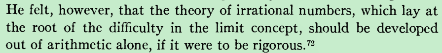

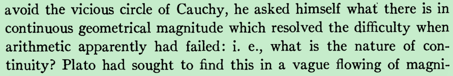

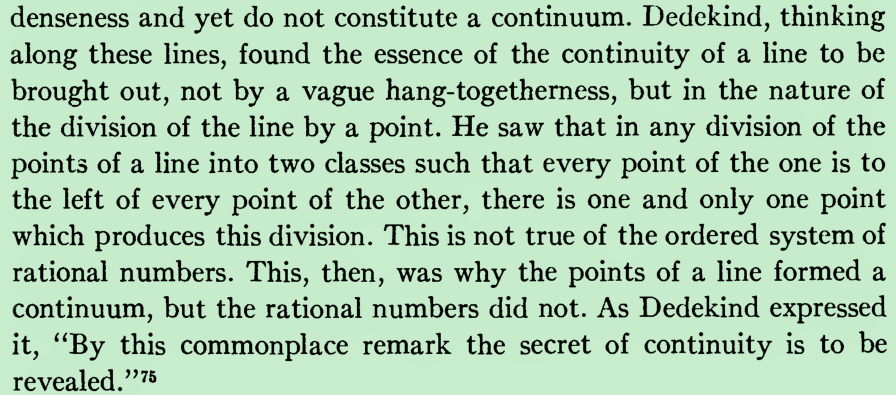

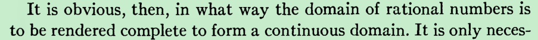

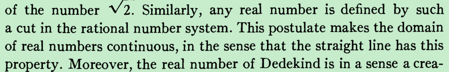

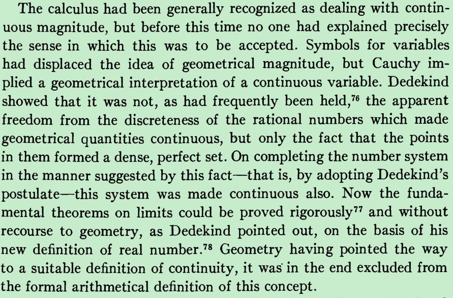

This postulate makes the domain

of real numbers continuous, in the sense that the straight line has this

property. 

I don't have time to write a full answer right now, but this may help. When you construct the real numbers you need to construct them out of things you have at hand. If you are constructing the reals, presumably you don't yet have real numbers to work with (why construct them if you did?), so you must use Q. Dedekind cuts are simply a way to represent real numbers in terms of rational numbers.

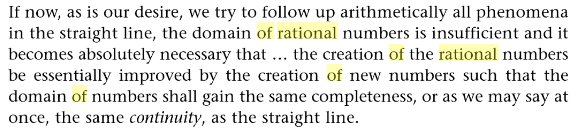

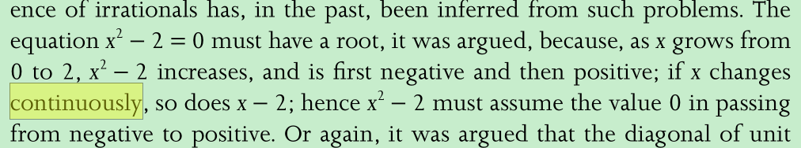

The

equation x 2 − 2 = 0 must have a root, it was argued, because, as x grows from

0 to 2, x 2 − 2 increases, and is first negative and then positive; if x changes

continuously, so does x − 2; hence x 2 − 2 must assume the value 0 in passing

from negative to positive.

好奇心驱使我们寻找连续，后面应该是so does x^2 − 2

罗素282

假设if x changes continuously，在只知道有理数的情况下要探讨x^2 − 2是否会等于0的问题就需要连续统

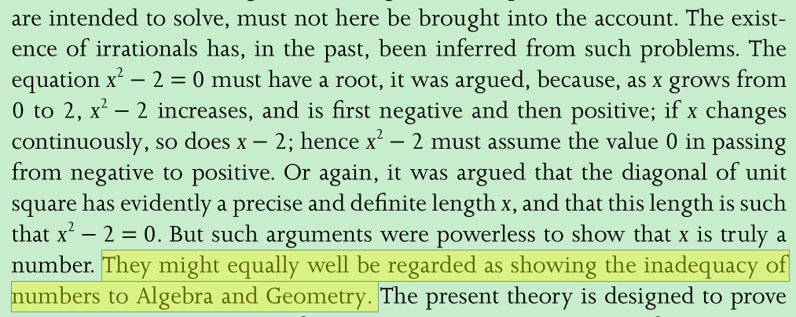

no, but yearling for the number continuum 

需要证明的是当分割点是无理数的时候要证明两个有理数cut之间只能有一个无理数不可能存在多个

yet there are many ways of dividing all rational numbers into

two classes, such that all numbers of one class come after all numbers of the

other class, and no rational number lies between the two classes, 

CONSTRUCTION OF R

If we compare the Dedekind process with the path we took through decimal

sequences, or with the Cantor process (to be dealt with below) and work

through each process in all details, there is no doubt that the Dedekind

process is by far the simplest. That is to say, if one puts value on every

detail of the proof and its understanding, then with Dedekind we have the

least trouble. 

"a real number is a Dedekind cut"

then, we have to do with a cut produced by no rational number, we create a new irrational number, 

应该说是reveal

概念介绍

A set partition of the rational numbers into two nonempty subsets 

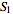

 and 

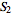

 such that all members of 

 are less than those of 

 and such that 

 has no greatest member.

a Dedekind cut, named after Richard Dedekind, is a partition of the rational numbers into two non-empty sets A and B, such that all elements of A are less than all elements of B, and A contains no greatest element. Dedekind cuts are one method of construction of the real numbers.

The set B may or may not have a smallest element among the rationals. If B has a smallest element among the rationals, the cut corresponds to that rational. Otherwise, that cut defines a unique irrational number which, loosely speaking, fills the "gap" between A and B. In other words, A contains every rational number less than the cut, and B contains every rational number greater than or equal to the cut. An irrational cut is equated to an irrational number which is in neither set. Every real number, rational or not, is equated to one and only one cut of rationals.

It is more symmetrical to use the (A,B) notation for Dedekind cuts, but each of A and B does determine the other. It can be a simplification, in terms of notation if nothing more, to concentrate on one "half" — say, the lower one — and call any downward closed set A without greatest element a "Dedekind cut".

Ordering of cuts

Regard one Dedekind cut (A, B) as less than another Dedekind cut (C, D) (of the same superset) if A is a proper subset of C. Equivalently, if D is a proper subset of B, the cut (A, B) is again less than (C, D). In this way, set inclusion can be used to represent the ordering of numbers, and all other relations (greater than, less than or equal to, equal to, and so on) can be similarly created from set relations.

还有数量关系 加减乘除运算

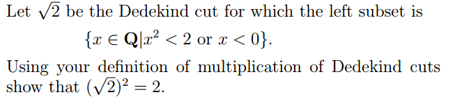

Dedekind的加减乘除运算

https://www.math.brown.edu/~res/INF/handout3.pdf

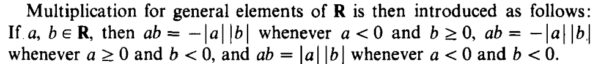

https://books.google.com.hk/books?id=AORWT3SsKOoC&pg=PA68&dq=dedekind+cut&hl=zh-CN&sa=X&redir_esc=y&sourceid=cndr#v=onepage&q=dedekind%20cut&f=true

I like the modern view that a real number is a Dedekind cut rather that "a Dedekind cut is produced by a real number". The second form in quotes seems to imply that real numbers exist already and they produce the cut. The former statement on the hand means that the cut itself is called a real number. 

When the real numbers are defined this way, they satisfy the intermediate value theorem. If f(x) is a continuous function that has 

 and 

, there is a number x between a and b with 

. Simply make the cut of those numbers with function value less than Q. That cut is the required number.

Every rational number determines two cuts; one where x is the largest element in L, and one where it is the smallest element in R. To avoid double representations, an arbitrary choice must be made: requiring L does not have a largest element (or, essentially equivalently, that R does have have a smallest element). 

The set of real numbers is then the set of all Dedekind cuts.

Dedekind constructed the number continuum by filling those gaps

 constructing the real numbers from

the rational numbers

 the set of rational numbers is riddled

with “holes” where there ought to be numbers. Here we will try to make this

statement more precise and then indicate how these holes can be “filled” result-

ing in the number continuum.

 In fact,

there are a lot more cuts than there are rational cut numbers. However, we can

fix this by enlarging the number system so that there is a cut number for every

Dedekind cut. The way this is usually done is to define the new number system

to actually be the set of all Dedekind cuts of the rationals.

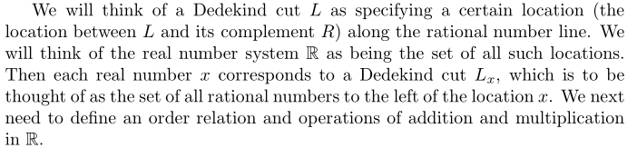

We will think of a Dedekind cut L as specifying a certain location (the

location between L and its complement R) along the rational number line. We

will think of the real number system R as being the set of all such locations.

Then each real number x corresponds to a Dedekind cut L x , which is to be

thought of as the set of all rational numbers to the left of the location x. 

Neither L has a largest element nor U has a smallest element. In this case we call

the cut a Dedekind gap, or simply a gap.

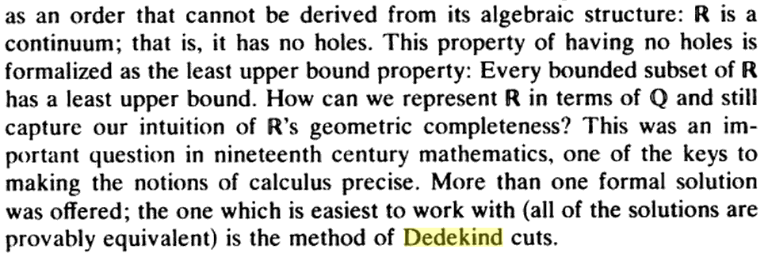

The idea is to “fill in” those gaps, getting a new system of numbers (real numbers) which can be placed in a one-to-one correspondence with points on a continuous line.

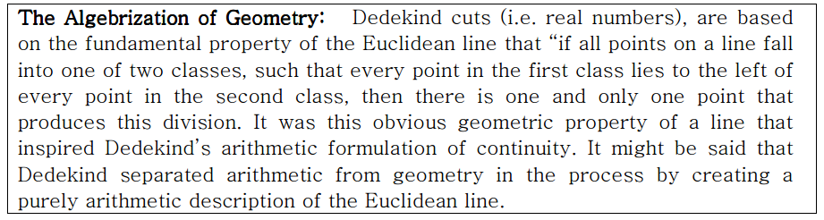

http://www.math.umaine.edu/~farlow/sec51.pdf

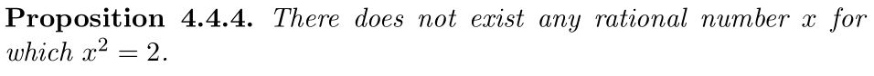

并不意味着有理数里有gap，只是说明了↑，

The rational system is already sufficient to do a lot of mathematics -

much of high school algebra, for instance, works just fine if one only knows about the rationals. However, there is a fundamental area of

mathematics where the rational number system does not suffice - that of

geometry (the study of lengths, areas, etc.). For instance, a right-angled

triangle with both sides equal to 1 gives a hypotenuse of

√ 2, which

is an irrational number, i.e., not a rational number;

 Thus, in

order to have a number system which can adequately describe geometry

- or even something as simple as measuring lengths on a line - one needs

to replace the rational number system with the real number system.

Since differential and integral calculus is also intimately tied up with

geometry - think of slopes of tangents, or areas under a curve - calculus

also requires the real number system in order to function properly.                        P95

 In Section 6.2

we shall introduce the extended real number system R ∗ , which allows one to give the

upper bound of +∞ for sets such as R + .

Because the system of rational numbers is not sufficient for geom-

etry, it is necessary to invent new numbers as measures of incommen-

surable quantities: these new numbers are called "irrational."

to every point

on the. number axis there corresponds a rational or irrational number

and that this totality of "real" numbers obeys the same arithmetical

laws as the rational numbers do.

 to get the reals

from the rationals is to pass from a “discrete” system to a “continuous”

one

 given purely in terms of rational numbers

直接假设一个连续体不行吗  干嘛要构造出来；终于认识到：可以假设数轴上的点都有一个数与之对应（加上些许公理），但是我们需要弄清楚这些数的性质，比如我们需要搞清楚是不是存在非0区间（a，b）（比如（0，a)a是无理数）内没有有理数的存在，只有不存在，才有1/n的极限为0的说法

我写的文章用了这个假设

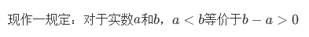

https://books.google.com.pe/books?id=sp_Zcb9ot90C&lpg=PR4&dq=Foundations%20of%20Analysis%20David%20French%20Belding&hl=zh-CN&pg=PA31#v=onepage&q=Foundations%20of%20Analysis%20David%20French%20Belding&f=true

https://zhuanlan.zhihu.com/p/27956796

公理化系统的优点

https://books.google.com/books?id=sp_Zcb9ot90C&lpg=PR25&dq=Foundations%20of%20Analysis%20David%20French%20Belding&hl=zh-CN&pg=PA25#v=onepage&q&f=true

