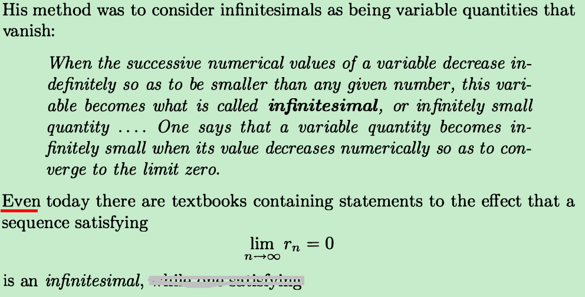
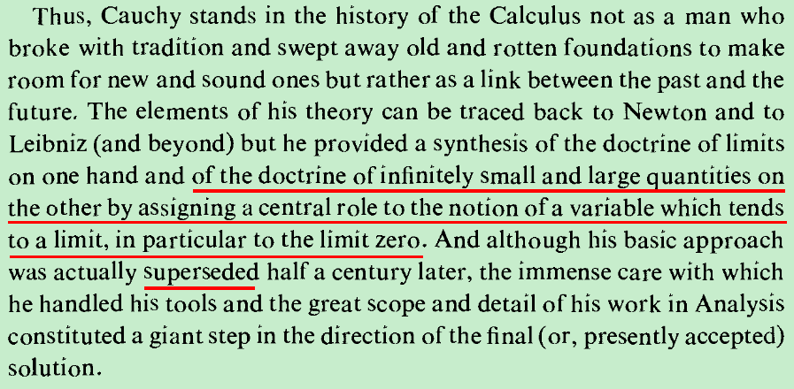
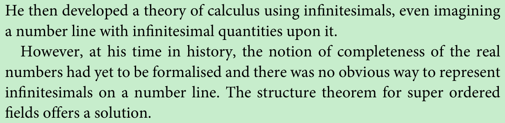
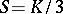
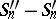
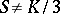

a curve

as a series of infinitely small straight lines, the area bounded by a curve

as an infinite sum of areas of infinitesimal rectangles.

infinitesimals are things so small that there is no way to measure them. 

In common speech, an infinitesimal object is an object that is smaller than any feasible measurement, but not zero in size—or, so small that it cannot be distinguished from zero by any available means. 

 it was found that infinitesimals could serve as a basis for calculus and analysis

The history of calculus is fraught with philosophical debates about the meaning and logical validity of fluxions or infinitesimal numbers. The standard way to resolve these debates is to define the operations of calculus using epsilon–delta procedures rather than infinitesimals. Non-standard analysis[1][2][3] instead reformulates the calculus using a logically rigorous notion of infinitesimal numbers.

Much of the earliest development of the infinitesimal calculus by Newton and Leibniz was formulated using expressions such as infinitesimal number and vanishing quantity. As noted in the article on hyperreal numbers, these formulations were widely criticized by George Berkeley and others. It was a challenge to develop a consistent theory of analysis using infinitesimals and the first person to do this in a satisfactory way was Abraham Robinson.

‘harks back to old metaphysical speculations concerning the structure of the continuum according to which this was made up of ultimate indivisible infinitely small parts.’ (ibid. p. 214.)

Cauchy himself is generally careful to explain that a null sequence becomes infinitely small, rather than saying that it is an infinitely small quantity.

a Null Sequence Become a Cauchy Infinitesimal

pb@ap.krakow.pl

341

gives an indirect proof of the equality 

 by establishing that, in view of (1) and (2), and because the difference 

 is infinitely small, the inequality 

 would lead to a contradiction

 Infinitesimals are not real numbers, and therefore don't live on the real number line in the first place. They are part of an extension of the real numbers, just as the real numbers are an extension of the rational numbers, and the rational numbers are an extension of the integers.

 while people use the word infinitesimal to convey intuition, the real numbers don't have any non-zero infinitesimals, so their explanation is flawed.

Cantor is believed by many professional mathematicians to have shown that there is only one consistent conception of the geometric continuum, with irrationals ‘filling’ the gaps between the rationals to ‘complete’ the real number line and leave no room for ephemeral entities that are ‘infinitesimal’.

 the notion of an infinitely small or indefinitely small quantity, the infinitesimal, which had a very strange property: it was sometimes zero and sometimes non-zero!

