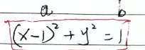
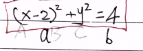
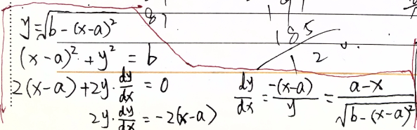
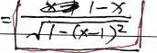
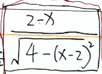
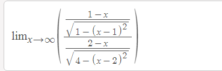
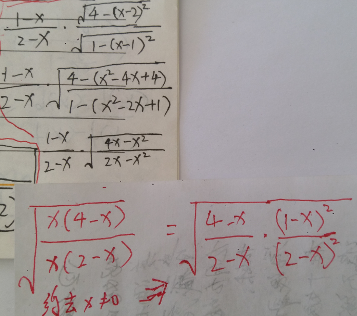

https://www.symbolab.com/solver/step-by-step/%5Clim_%7Bx%5Cto%5Cinfty%7D%5Cleft(%5Cfrac%7B%5Cfrac%7B1-x%7D%7B%5Csqrt%7B1-%5Cleft(x-1%5Cright)%5E%7B2%7D%7D%7D%7D%7B%5Cfrac%7B2-x%7D%7B%5Csqrt%7B4-%5Cleft(x-2%5Cright)%5E%7B2%7D%7D%7D%7D%5Cright)

\lim _{x\to \infty }\left(\frac{\frac{1-x}{\sqrt{1-\left(x-1\right)^2}}}{\frac{2-x}{\sqrt{4-\left(x-2\right)^2}}}\right)

=1

