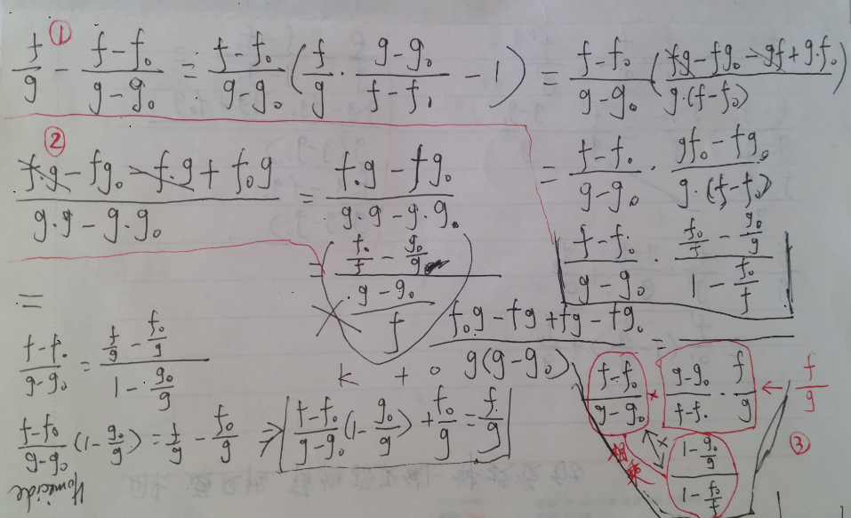
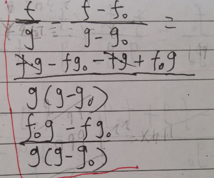
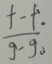
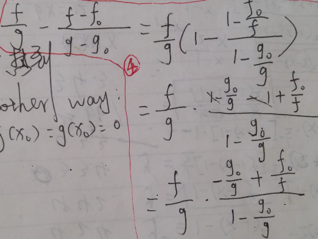

在证明洛必达法则时考虑的问题

下面用的是相减方式

①跳去公因子的方法不容易想到，因为压根就没有公因子，最后需要f和g都趋于无穷大才有结论吧？

②通分相减的方式，若f和g都趋于无穷大，能得到分子→0，但是分母的状态不确定，所以估计还需要什么结论的辅助才能出结果吧？

③由

变出f/g的简单粗暴方式，后两项结合后还需要f和g都趋于无穷大才有结论吧？

另一种提取公因子的做法，

同样是不容易想到，因为压根就没有公因子，最后需要f和g都趋于无穷大才有结论吧？

