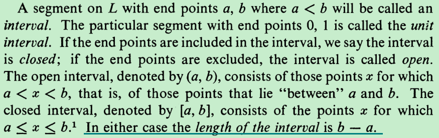
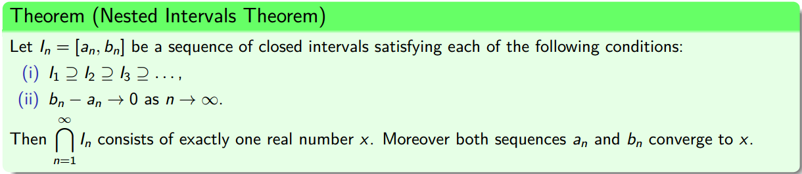

一个点的长度是多少？What is the length of a point ?

From the perspective of analytic geometry, an interval is composed of infinitely many points,  while after the length of an interval was defined, it is intuitively to believe its length is the sum of the length of all points within it, then it becomes meaningful to ask the length of a point and the relationship between the length of a point and the length of an interval?

Considering the singleton case ${\displaystyle [a,a]=\{a\}}$, the length of the interval is 0, since the single point $a$ is included in the interval, thus the length of a point cannot exceed the length of that interval, while the concept of length cannot be negative, so the length of a point is 0.

Another perspective of figuring out the length of a point is using the nested intervals theorem.

Considering the point included in each of these intervals, since there always exists interval whose length could be smaller than each positive real number, unless the length of a point is 0, or else the point couldn't be included in each of these intervals.

http://math.stackexchange.com/questions/1936865/what-is-the-length-of-a-point-on-the-real-number-line

After figuring out the length of a point, this moved us further to sum the length of each point within the interval, since there are infinitely many points within the interval, it is error-prone to represent the length of all points within the interva by the series 

$$0+0+0+...$$

for there are uncontablely infinite many points within the interval, the series only computed out the sum of the length of contablely infinite many points within the interval. While this failure may inspire us to ask whether if the sum of the length of uncontablely infinite many points equal to the interval length, also No!

The Cantor set contains an uncountably infinite number of points, while the total length of all these points is still 0.

https://en.wikipedia.org/wiki/Cantor_set

Your original belief--the length of an interval is the sum of the length of all points within it, destroyed by the conclusion conducted from Cantor set, you may still want to dig the topic further, see the measure theory! I will come back to update this article once I have deep insight about this topic!  