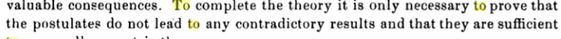
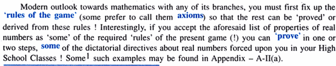

The question immediately arises as to how it is possible to reason correctly

while refusing to define the things being discussed, and thus escaping an 

infinite regression in definitions. The answer is very simple: it is enough to force

oneself never to state any proposition about geometrical objects and their 

relations which is not the logical consequence of the system of axioms governing

them (these too being listed exhaustively). 

公理的三个要求

 independent、

Hilbert points out that these axioms are not independent; some can

be deduced from the others.

Hilbert was not aware at this time of the difficulty of proving

the consistency of axioms for real numbers.

https://books.google.com/books?id=PTWqXzRLzC4C&pg=PA16

