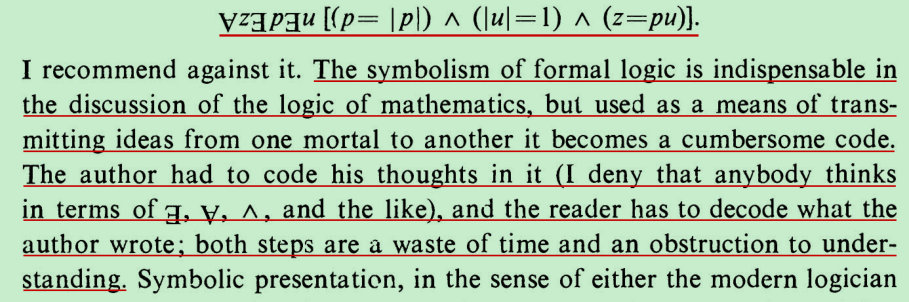
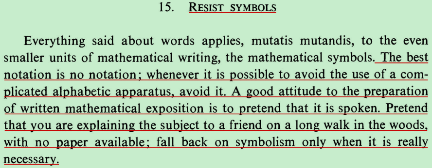
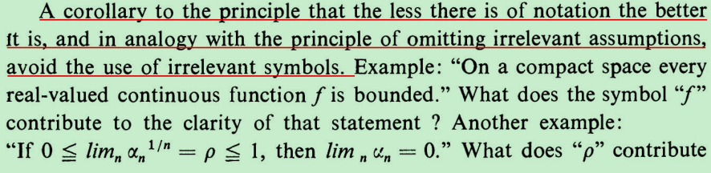
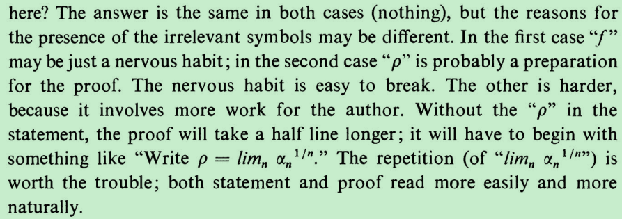
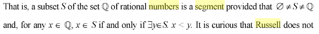
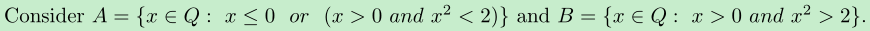
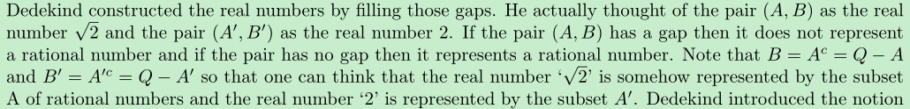

数学文章的作者把自己的想法用符号表示需要费时间，读者理解符号化表示的数学想法也需要花时间去按照各个符号表示的意思去解读，用符号表示的数学思不便理解，其原因在于最利于我们人类理解的语言描述应该要像口语、讲故事的语言一样通俗易懂，用符号表达数学思想虽然可以变得简洁，但是相反这种“数学语言”不那么直白，也就增加了理解难度。

An old French mathematician said: "A mathematical theory is not to be considered complete until you have made it so clear that you can explain it to the first man whom you meet on the street." 

 Russell offers a straightforward nominal definition of real

numbers: a real number is a segment区段 of rational numbers. 

segment 的定义那种好理解？

A (lower) segment L of rational numbers is a non-null class of rationals, not

including all rationals, with the property that a rational r is a member of L if and only

if there is rational s in L such that r is less than s (PoM, p. 27r).

from https://books.google.com.hk/books?id=Eq8ZualfMRkC&pg=PA170&lpg=PA170&dq=Russell+dedekind+real+numbers+segment&source=bl&ots=Nit1BNxy9f&sig=441alyRF2Abz6QFivklcSFrUNHI&hl=zh-CN&sa=X&ved=0ahUKEwjDnt-JqObSAhWl6oMKHRLlDKwQ6AEIGzAA#v=onepage&q=Russell%20dedekind%20real%20numbers%20segment&f=true

高斯所说：“我们需要的是想法，而不是符号。”

霍金公式一半读者销量

