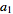
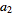
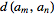
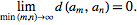

有理数域讨论极限The falsity of this doctrine

is immediately

apparent from the fact that irrational numbers may

easily be

defined as the limits of sequences of rational

numbers,

https://math.stackexchange.com/questions/2260088/the-definition-of-irrational-numbers-and-the-proof-of-cauchys-theorem/2260339?noredirect=1#comment4651544_2260339

A sequence 

, 

, ... such that the metric 

 satisfies

Cauchy sequences in the rationals do not necessarily converge, but they do converge in the reals.

https://math.stackexchange.com/a/2260339/34603

https://math.stackexchange.com/questions/2260088/the-definition-of-irrational-numbers-and-the-proof-of-cauchys-theorem/2260339?noredirect=1#comment4651544_2260339

必须说明正有理数的下确界为0才能在有理数系内谈极限

在有理数系内怎么证明正有理数的下确界为0？

正有理数下确界肯定大于等于0，但是也不可能是正有理数

这个下确界可不可能是0和正有理数集合间的其他非有理数？

Note that the rationals are not complete. For example, the sequence (1; 1.4; 1.41; 1.414; 1.4142; 1.41421…), where each term adds a digit of the decimal expansion of the positive square root of 2, is Cauchy but it does not converge to a rational number. (In the real numbers, in contrast, it converges to the positive square root of 2.)

The completeness of the real numbers paves the way for develop the concept of limit, Chapter 2, which in turn allows us to establish the foundational theorems of calculus establishing function properties of continuity, differentiation and integration

