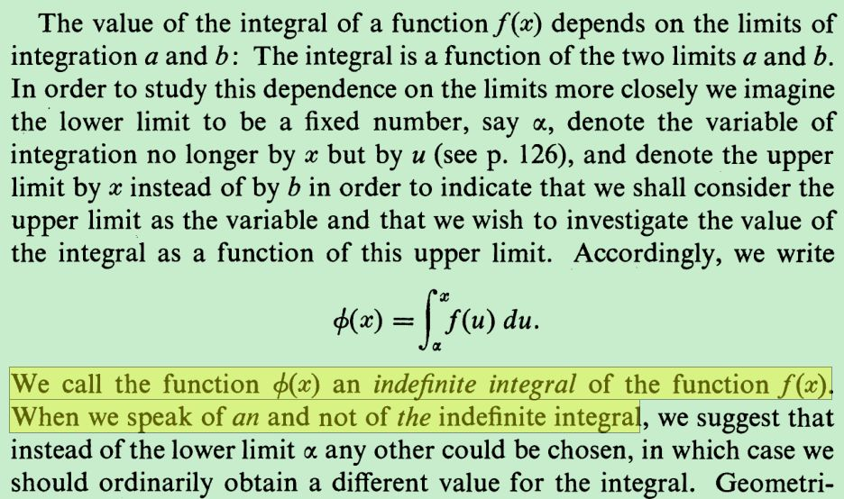

α应该还是要在函数定义里取，这是从如下强调里认识到的

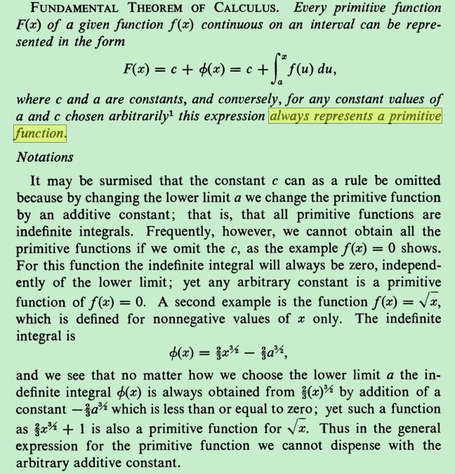

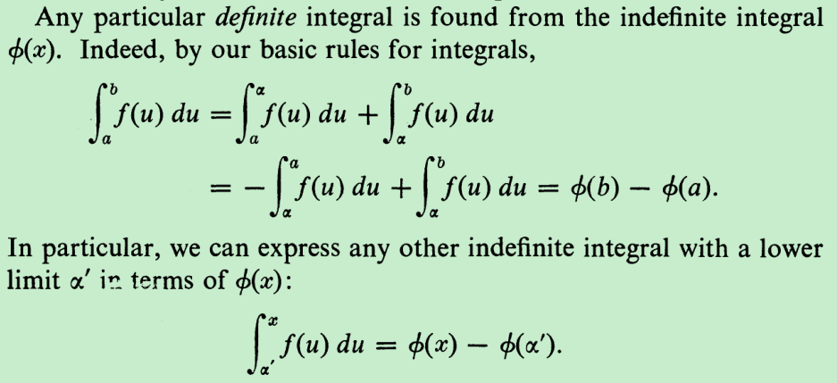

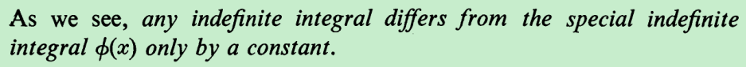

和微积分基本定理的差别在于是否认识到φ'(x)=f(x)

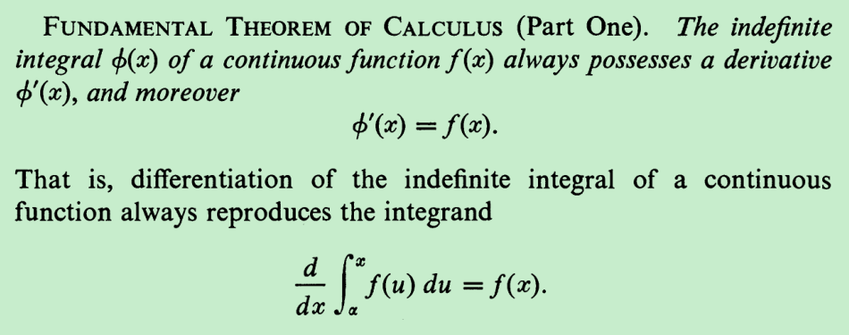

虽然认识到这种性质，但是关键还是要认识到可以用来计算定积分

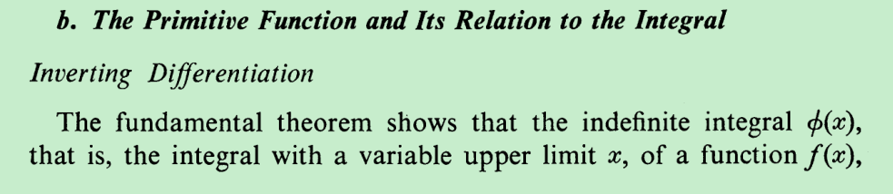

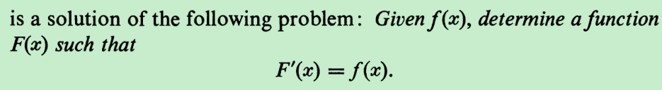

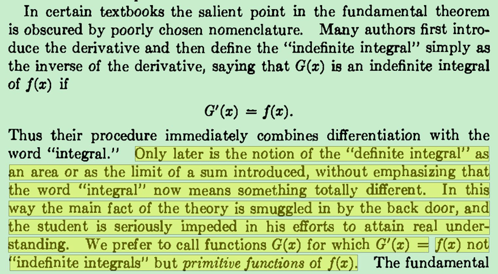

如果像国内教材那种先介绍不定积分，那么会让学生觉得这个概念莫名其妙，以至于后面学到定积分的时候二者的关系不甚明确。

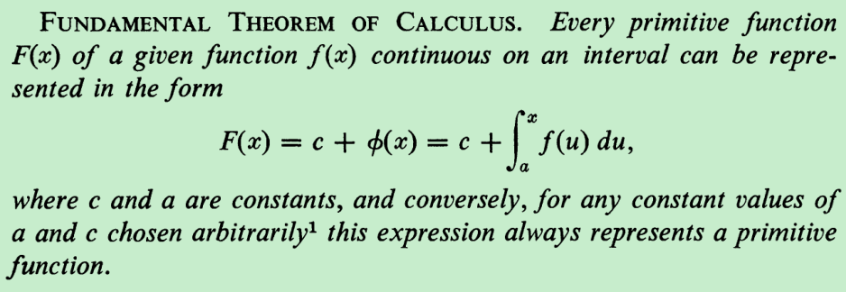

以前我看不到这种写法的意义，相反还觉得很繁琐，但现在按照先介绍定积分，然后不定积分（上面最后的加号后面的式子），再原函数的“正统”顺序来看，我发现这个式子沟通了三者，也让我们看到了这三个概念的联系与区别。

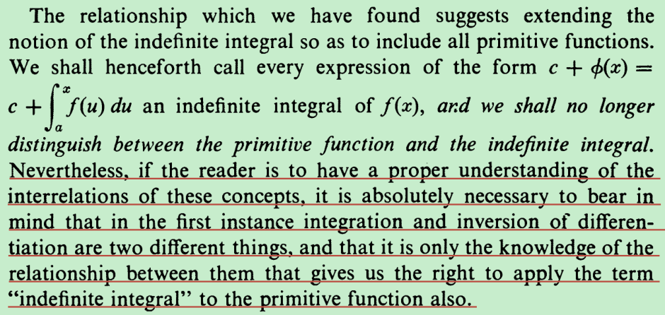

作者说认识到这三者的关系之后就会把“原函数”和“不定积分”视为一谈，但我认为这种做法还是不利于我们长久分清这二者的关系，划线部分就是有见地的认识。

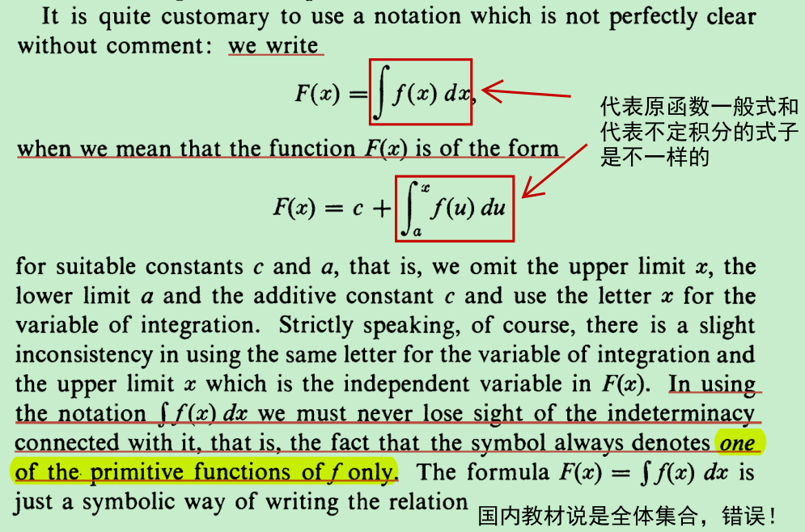

虽然这种探究可能无关宏旨，但是我觉得一个认真学数学的人应该这么做。

