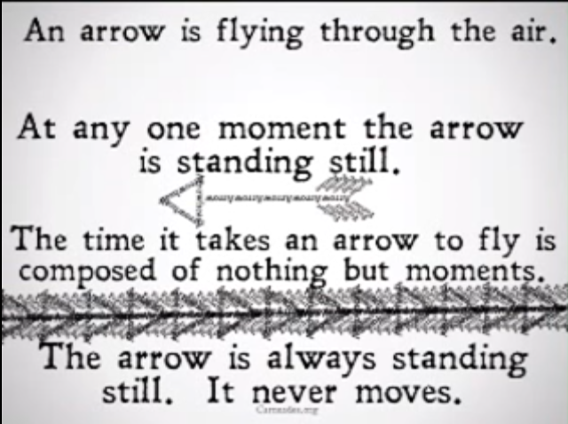

飞矢不动悖论如下

来自：https://www.youtube.com/watch?v=cw3V5BruAwI

在每段时间的起点，物体有一个固定位置，可称其为物体的初始位置，要描述一个物体运动和静止我们需要观察其在一段时间内是否有离开其初始位置，有则动，无则静。

因此，对于芝诺飞矢不动悖论，其描述里说“每个时刻”物体都静止，这种描述本身是错误的，不能说物体在一个时刻静止，只能说物体在一段时间内静止。

这个悖论和这个矛盾有点相似：解析几何里把线段看作是无穷多个点组成的，按理说线段的长度应该是这些点的长度总和，但是每个点的长度是0，即便是无数多个0加起来其和仍然是0，这就推出每条线段的长度都为0的谬论。

我认为其矛盾缘由在于：我们使用的加法，无论是对有限个加数还是无限可数个加数，加数组成的集合都是可数集（countable set），也就是说我们的加法只适用于其加数是可数集的情况，而组成一条线段的点的集合是不可数无限集（uncountable set or uncountably infinite set）（见康托对角线证法，其证明的是实数集不可数，但是别忘了数轴上实数和点一一对应），这时候再用加法就是错误的了，因而得出错误的结论。要解决这个悖论估计需要定义不可数无穷多个0的加法，但是这可能会与康托用一一对应得出“所有线段都有相同个数的点”相矛盾。

对于无穷集合的比较准则——“一一对应”，一一对应能够比较有限可数集的大小，这是很直观的，康托只是做了个定义，然后就把这条准则用到了无穷集合的比较里，结果得出了“整体等于局部”这个在有限可数集里绝对不可能的事，这让我怀疑“一一对应”能否作为无穷集合的比较准则，康托也并没有严格证明这条准则用于比较无穷集合的大小是没有问题的。所以，到头来，如果我们要坚持一一对应原则作为比较集合的标准，那么我们在无限集里就不得不违背”整体大于局部“这个在有限可数集里绝对正确的事实，相反，我们就不得不承认“一一对应”不能作为无穷集合的比较准则。

