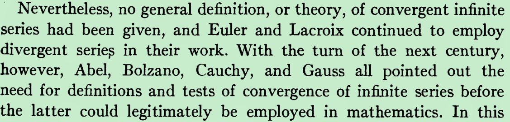

VI. The Period of Indecision

The History of the Calculus and its Conceptual Development

Mathematics can take pride in the absolute correctness of its results
these days, but in the early days, many people made very loose 
arguments and "proved" some things which really make no sense.  Even 
Leonard Euler provided examples of such nonsense.

When people realized these loose arguments were becoming a real 
threat to the absolute correctness of mathematical theorems, some of 
them decided to try to develop mathematics very, very carefully.

analytic geometry of Descartes当时并没有建立实数和点一一对应

从数学从上往下建立的过程看人类的思维方式，看数学理论的发展方式，

Thus, once the logical approach to the natural numbers was attained,

the problem of building up the foundations of the real number system was

completed. As we have already noted, generally the men who worked on

the theory of irrationals assumed that the rational numbers were so thoroughly

understood that they could be taken for granted, or made only a minor

gesture toward clarifying them. After Hamilton had grounded the complex

numbers on the real numbers, and after the irrationals were defined in

terms of the rational numbers, the logic of this last class was finally created.

The historical order was essentially the reverse of the logical order required

to build up the complex number system.

Extending a domain by introducing new symbols in such a way that the laws which hold in the original domain continue to hold in the larger domain is one aspect of the characteristic mathematical process of generalization. The generalization from the natural to the rational numbers satisfies both the theoretical need for removing the restrictions on subtraction and division, and the practical need for numbers to express the results of mewmrement. It is the fact that the rational numbers fill this two-fold need that gives them their true significance. As we have seen, this extension of the number concept was made possible by the creation of new numbers in the form of abstract symbols like 0, -2, and 3/4. Today, when we deal with such numbers as a matter of course, it is hard to believe that as late as the seventeenth century they were not generally credited with the same legitimacy as the posi- tive integers, and that they were used, when necessary, with a certain amount of doubt and trepidation. The inherent human tendency to cling to the "concrete," as exemplified by the natural numbers, was responsible for this slowness in taking an inevitable step. Only in the realm of the abstract ean a satisfactory system of arithmetic be created

Extending a domain by introducing new symbols in sueh a way that the laws whieh hold in the original domain continue to hold in the larger domain is one aspeet of the characteristic mathematical process of generalization. The generalization from the natural to the rational numbers satisfies both the theoretical need for removing the restrictions on subtraction and division, and the practical need for numbers to express the results of measurement. It is the fact that the rational numbers fill this two-fold need that gives them their true significance. As we have seen, this extension of the number coneept was made possible by the creation of new numbers in the form of abstract symbols like 0, —2, and 3/4. Today, when we deal with sueh numbers as a matter of eourse, it is hard to believe that as late as the seventeenth eentury they were not generally eredited with the same legitimacy as the posipositive integers, and that they were used, when necessary, with a certain amount of doubt and trepidation. The inherent human tendency to cling to the "concrete," as exemplified by the natural numbers, was responsible for this slowness in taking an inevitable step. Only in the realm of the abstraet ean a satisfactory system of arithmetic be ereated.

