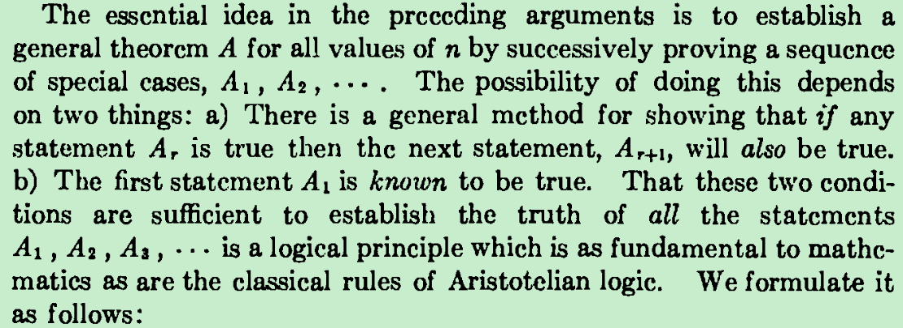
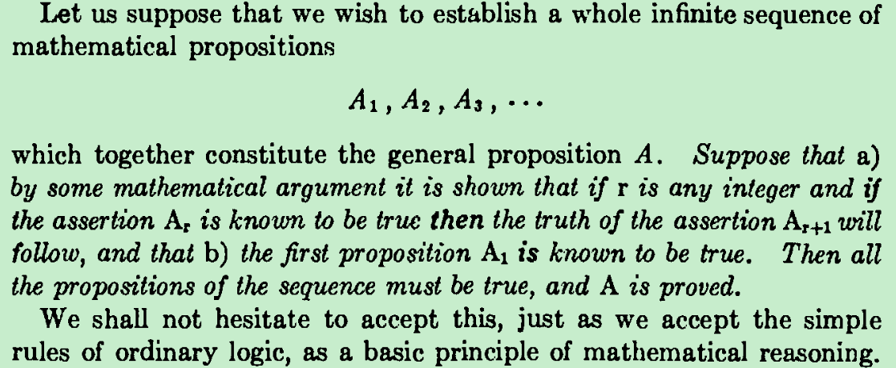
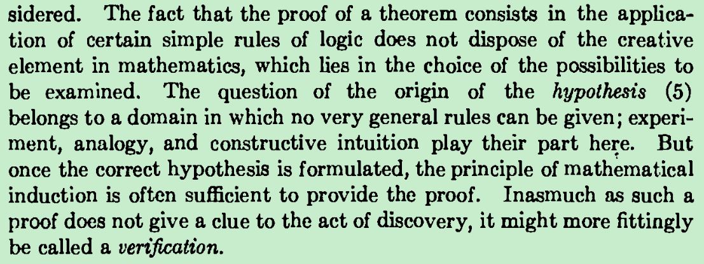

起始条件为真+可递推   就能保证对所有的n都成立。

如果命题对n成立，那么对n+1也成立（可递推），这时候如果对起始的n0核实确实成立的话（起始点确实如此——为真），那么根据这两个条件就可以知道对n0后面的所有整数都成立（为真）了。就好比多米诺骨牌中间的一块牌，如果它倒了，那么后面的一块肯定倒，但是这仅仅只是一种假设，要全部都倒，我们还必须确定第一块已经确实倒下了才行。

数学归纳法的证明包含两部分：

The method of induction requires two cases to be proved. The first case, called the base case (or, sometimes, the basis), proves that the property holds for the number 0. The second case, called the induction step, proves that, if the property holds for one natural number n, then it holds for the next natural number n + 1.

 

The simplest and most common form of mathematical induction infers that a statement involving a natural number n holds for all values of n. The proof consists of two steps:

 

The base case: prove that the statement holds for the first natural number n0. Usually, n0 = 0 or n0 = 1; rarely, but sometimes conveniently, the base value of n0 may be taken as a larger number, or even as a negative number (the statement only holds at and above that threshold), because these extensions do not disturb the property of being a well-ordered set.

The step case or inductive step: prove that for every n  ≥  n0, if the statement holds for n, then it holds for n + 1. In other words, assume the statement holds for some arbitrary natural number n  ≥  n0, and prove that then the statement holds for n + 1.

The hypothesis in the inductive step, that the statement holds for some n, is called the induction hypothesis or inductive hypothesis. To prove the inductive step, one assumes the induction hypothesis and then uses this assumption, involving n(过程中会用到别的一些被证实了的公式定理，相当于是一些客观条件（如重力在物体下落过程中，空气阻力并不会大于重力导致物体不会下落），它们的正确性支撑了确实会往后倒), to prove the statement for n + 1.

 

https://en.wikipedia.org/wiki/Mathematical_induction#Examples

accept it as an axiom

数学归纳法 换个更贴切的名字就是“数学核实法”

http://www.kebenzhan.com/renjiaoban/gaosan/shuxuedisance_xuanxiu2/46528.html

http://www.kebenzhan.com/renjiaoban/gaosan/shuxuedisance_xuanxiu2/46531.html

https://wenku.baidu.com/view/de017e57c77da26924c5b0ab.html

