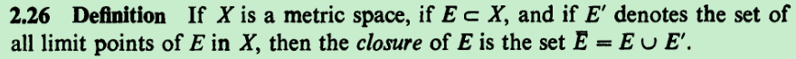
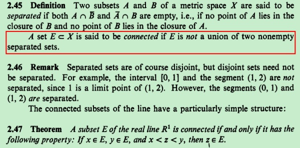
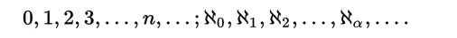

谁能帮我解决下这个困惑？感激不尽！！！

数轴上代表[0,1]的线段AB和代表[2,3]的线段EF，现在把EF向左平移使其恰好和AB相接，记平移后的线段EF为CD，那么现在代表D点的那个数是多少？

显然CD会包含(1,2]这一段，但是，因为B点已占据了1这点，那么C只能占据1右边的某点，从而使得D只能占据2右边的某点，那么现在代表D点的那个数是多少？

我对“AB恰好和CD相接”的定义是：

AB和CD没有交集，任何在A和D间的点，不在AB上就在CD上。

这个“恰好相接”的定义来自于这种启示：数轴上代表[0,1]的线段和(1,2]这一段就恰好相接，二者没有交集，任何在0和2间的点不在[0,1]上就在(1,2]上

最后，我们被教导"实数和数轴上的点一一对应"，并且任意小不存在实数里，也就不在数轴上了，故而“2+任意小”不能代表D点的那个数值

rudin  阅读器52

你看一下，相接并不要求交集是一个点

相交一定相接，反之则否

无数个[1/2^n,1]的交集是（0，1】,感觉可以有0；...,1/2^n,...1/2^3,1/2^2,1/2^1,
1/2^n逼出了一切正数，那么可以定义1/2^n （n-》oo）的值为最小正数

https://en.wikipedia.org/wiki/Cardinal_number

1/2^n （n->oo），无限的飙下去，从我们现有的结论“1/2^n的极限”（排除法出来的结果），完全可以定义1/2^n （n->oo）为0后面的最小正数

极限就算是一种无限排出的方法，1/2^n跑完正整数（排除）后得到0，那么1/2^n的终点就应该是最小正数

换个问题，如果我们说0是刚好在（0，1]前面的那个数，那么是否有刚好在（0，1]后面的那个数呢？如果有，数值是多少？

就好比0,1分别是刚好在（0,1）前后的数，我现在问的是：否有刚好在（0，1]后面的那个数呢？如果有，数值是多少？

在实数系里，E是一个非空区间（a,b]，如果实数β满足：

① b<β;

② 如果a<x<β，那么x∈E；

则称实数β是刚好在E右边的那个数。

相反，大家可以想想刚好在E左边的那个数（存在的，是a啦）

这样的β存在吗？

---从刚好前面那个来看是存在的

