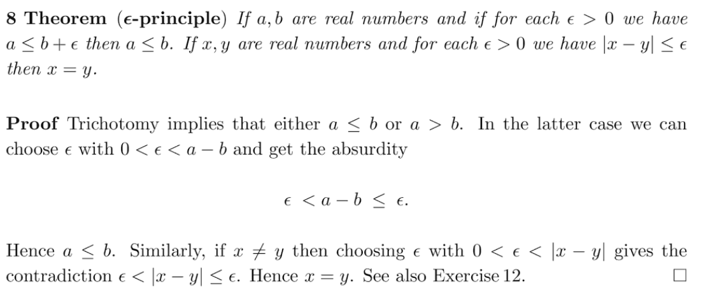

https://books.google.com.hk/books?id=2NVJCgAAQBAJ&pg=PA20&dq=Archimedean+Property+of+rational&hl=zh-CN&sa=X&ved=0ahUKEwjZnf_D9OXWAhUj3YMKHYWzDMkQ6AEINjAC#v=onepage&q&f=true

21页

efore one can appreciate a precise formulation of a concept or theorem, he

must know what idea is being formulated and what exceptions or pitfalls the wording is trying to

avoid. Hence he must be able to call upon a wealth of experience acquired before tackling the

rigorous formulation. Furthermore, having students master a polished deductive organization does not

teach them how to think and how to do mathematics, for thinking and doing are not deductive

processes. How can discovery take place when students are asked to work with ideas that are already

overladen with sophistication and refinement? Finally, the rigorous approach is misleading. Because

the introductory calculus course is the student’s first contact with higher mathematics, he obtains the

impression that real mathematics is deductive and that good mathematicians think deductively.

Rigor has its place in mathematics education. It is a check on the creations and it permits an

aesthetic (as well as an anaesthetic) presentation. But it is also to some extent gilt on the lily and an

interdiction against the inclusion of functions which rarely occur in practice and which must even be

invented with Weierstrassian ingenuity. A rigorous first course in calculus reminds one of the words

of Samuel Johnson; “I have found you an argument but I am not obliged to find you an understanding.”

Even if the rigorous material is understood, its value is limited. As Henri Lebesgue pointed out:

“Logic makes us reject certain arguments but it cannot make us believe any argument.”

