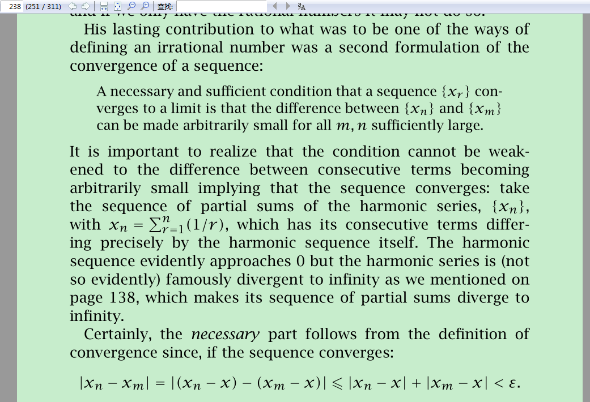

有极限的充要条件与柯西序列

But it is the sufficient part that carries with it what is needed to

define irrational numbers, provided care is taken not to assume

the existence of the limit, as we shall see.

Then came an 1867 publication Prinzip der Permanenz der for-

malen Gesetze of Hermann Hankel in which he asked whether

there were other number systems which had essentially the same

rules as the real numbers; it seems to have been the first pub-

lishedreferencetotheapproachofWeierstrass,whichwemention

below, but its author evidenced his scepticism with:

Every attempt to treat the irrational numbers formally and

without the concept of (geometric) magnitude must lead to the

most abstruse and troublesome artificialities, which, even if

they can be carried through with complete rigour, as we have

every right to doubt, do not have a higher scientific value.

