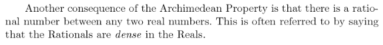
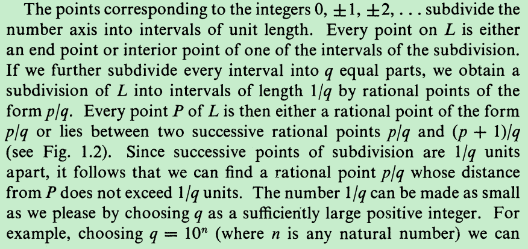
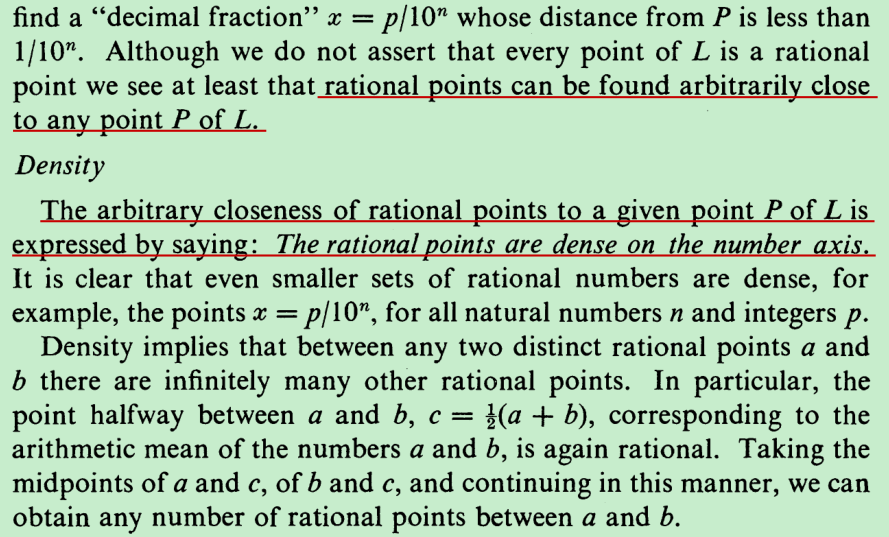
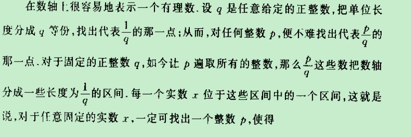
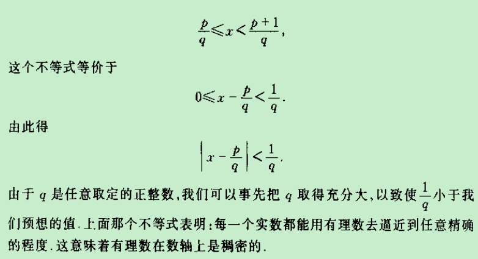

Graphical Representation of Rational Numbers. 

[有理数稠密性.docx](attachments/有理数稠密性.docx)

[从有理数的稠密性到数的连续体.docx](attachments/从有理数的稠密性到数的连续体.docx)

The rationals came from quotients of the integers, so a rational number can always be written in the form p/q, where p and q are integers and q≠0. We can make this representation unique by requiring that q is positive and that p and q have no common factor larger than 1. Then in this way, a integer is a fraction with 1 as the denominator, thus every rational number could be written in the form of fraction.  

they do not 

Even from a

theoretical viewpoint, since the set of rational points covers the line

densely, it might seem that all points on the line are rational points.

If this were true, then any segment would be commensurable with the

unit.

if we assume that to

every segment corresponds a number giving its length in terms of the

unit,

1 A more complete exposition is given in What Is Mathematics? by Courant and

Robbins, CHAPTER III.

每一个实数都能用有理数去逼近到任意精确的程度，这就是有理数的稠密性。The rational points are dense on the number axis. 

意味着gap长度为0

dense Q dense R

---

