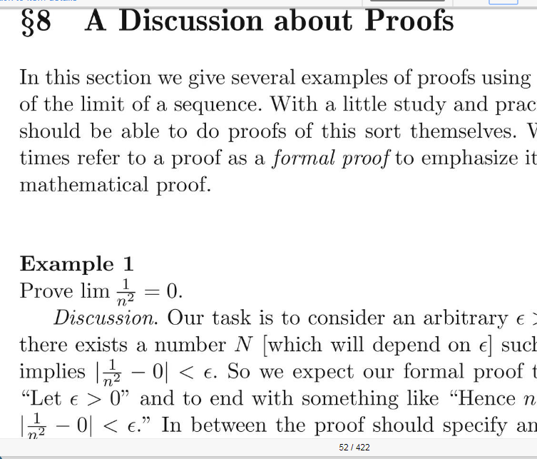
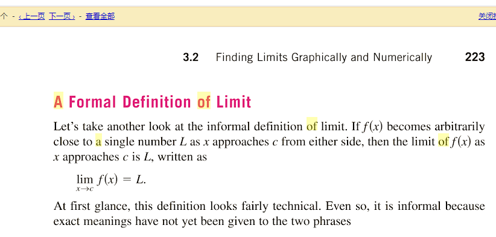

学高数至今，我还未曾看到过任何一份资料对于“不能依赖于极限的直观定义而要采用(ε, δ)语言来定义极限的理由”做出透彻的解释。

https://archive.org/stream/pdfy-_KqLYE14P4NqcS2j/Elementary%20Analysis%20The%20Theory%20of%20Calculus%20%282nd%20edition%29#page/n51/mode/1up

https://books.google.com/books?id=IBjvMZSIsCYC&lpg=PA262&dq=tangent%20of%20a%20curve&hl=zh-CN&pg=PA223#v=onepage&q=tangent%20of%20a%20curve&f=true

Karl Menger found mathematicians to be too parsimonious with regard to variables, so he formulated his Law Against Miserliness, which took one of two forms: "Entities must not be reduced to the point of inadequacy" and "It is vain to do with fewer what requires more."

改变定义E为1/10^n，n是任意自然数

仿制

as we would put it since Weierstrass, that for any k > 0, there exists a p such that for all n, m > p, |xn − xm | < 1/k; these are called fundamental sequences. In particular, bounded non-decreasing sequences are fundamental.

In the light of the precision

of the Weierstrassian theory of limits, however, the question is seen to

be entirely inapposite. The limit concept does not involve the idea of

approaching, but only a static state of affairs. The single question amounts really to two: first, does the variable f(x) have a limit L

for the value a of x. Secondly, is this limit L the value of the function

for the value a of x. If f(a) =

L, then one can say that the limit

of the variable for the value of x in question is the value of the

variable for this value of x, but not that/(«) reaches f (a) or Z, for this

latter statement has no meaning.

