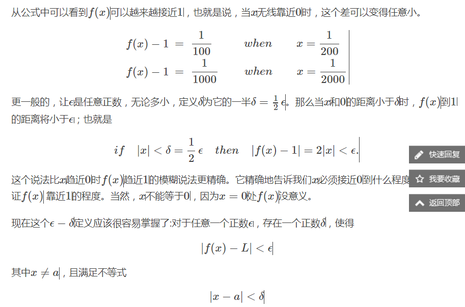
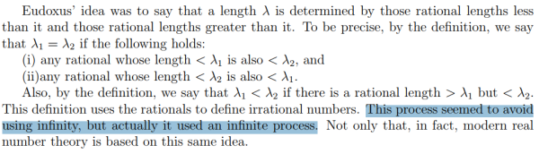

While the limit of (1/2)n as n goes to infinity is 0 each value is defined in that sequence.

rather than say that a limit is infinity, the proper thing is to say that the function "diverges" or "grows without bound". In particular, the following informal example of how to pronounce the notation is arguably inappropriate in the classroom (or any other formal setting). In any case, for example the limit of f as x approaches a is infinity, denoted

means that for all 

 there exists 

 such that 

 whenever 

.When the successive values attributed to a

variable

approach indefinitely a fixed value so as to end by

differing from it

by as little as one wishes, this last is called the limit of all the others.

The limit is a concept which on one level is quite intuitive, but

to pin down rigorously turns out to be quite difficult. 

In Section 4.4 we explored the “gaps” in the rational numbers; now

we shall fill in these gaps using limits to create the real numbers. The

real number system will end up being a lot like the rational numbers, but

will have some new operations - notably that of supremum, which can

then be used to define limits and thence to everything else that calculus

needs.

We also remark that the Eudoxian definition of proportionality uses the term “for every
...” to avoid mentioning the infinite process, which is the same as the modern −δ definitions
of limit and continuity today.无限过程中切片共性观察

