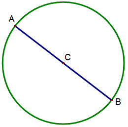

AC和BC在同一直线上共点，但是从圆心到A、B两点的距离相等，推出AB=2AC=2BC

撇开这个图不谈，在直线上2BC

少一个点并没有影响AB=2AC=2BC

从BC延长出来的那一倍，那一部分新的线段应该和旧的没有交集，恰好相接，这样拼出来的才是严格的两倍长度，但现在，即便共点，仍然还是2倍长度，可见点的宽度或宽度必须是0

直径是半径的2倍，应该还是被灌输和被圆规误导的吧

---

上面都错了，应该从定义来看，如果有宽度的话就是线断了，不是点了

两条直线相交成任意夹角来看点在2D世界的维度，由于直线宽度为0，否则就是无限长的形了，交点即在AB又在CD上面，则在AB和CD这两个方向的垂直方向维度为0，任意夹角来看，各方向维度都是0

