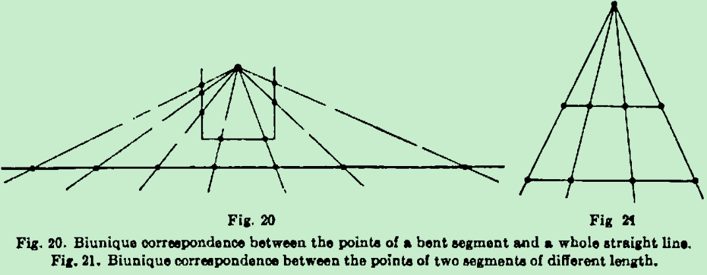

Is a line segment really composed of points?

Numbers are 
useful things for locating points on a straight line. Take any line 
and put a zero on it somewhere. Then take an arbitrary distance in 
either direction on the line and mark that point as 1. Then keep 
taking the same number of distances in the same direction and you will 
get to 2, 3, etc. Go back to 0 and take the same distance in the 
opposite direction. You will get -1, -2, -3, etc. That's a number 
line.

数轴上间隙宽度为0并不代表没有间隙，比如（-∞，0）∪（0，+∞），0就是间隙，点的宽度为0，但是可以有点间隙

http://www.maa.org/sites/default/files/pdf/upload_library/22/Polya/00494925.di020708.02p0139b.pdf from http://www.maa.org/programs/maa-awards/writing-awards/how-big-is-a-point

康托集来说明不可数无穷多个点的长度和是0

107

依赖于一一对应说明不可数无穷大等势这条公理（假设），

以o点旋转过来，在这个过程中一一对应，但是最终长度不同

如果由点一个挨着一个组成（点长度为0），那么根据点和数一一对应可推出实数可数，和康托的理论矛盾

如果由点一个挨着一个组成（点长度不为0），则有根据点和数一一对应可推出实数可数，和康托的理论矛盾，同时和根号2矛盾

criticised by Pappus of Alexandria on the grounds that there was nothing in the axioms that asserted two intersecting circles in fact intersect in points.