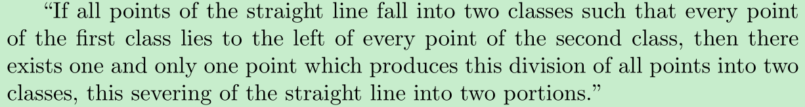
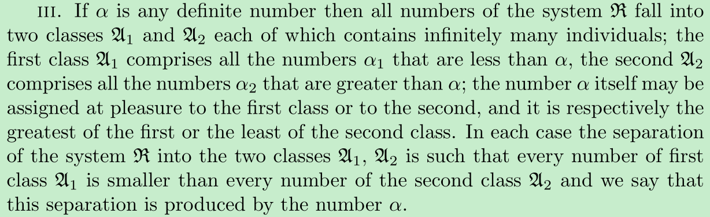

Hello Paramanand,

I said I would discuss Russell's definition of irrational numbers and his criticism to Dedekind with you nearly one month ago at here, now it is time! 

Page 293 of The History of the Calculus and its Conceptual Development says

He(Russell) felt that the definitions previously given(including Dedekind's) either disregarded the question of the existence of the irrational numbers or artificially postulated new numbers, leaving some doubt as to just what they are. 

so that Russell made his own definition of irrational numbers.

However,  after read his definition and the detailed description of his criticism to Dedekind's construction of real numbers in his book Principles of Mathematics(from page 281,paragraph 265 on), I cannot understand how he could use only rational number and segment of rational numbers to form the number continuum, besides, I don't think his criticism to Dedekind's is reasonable. 

At page 282 of his book, his questioning Dedekind that  

(1).What right have we to assume the existence of such numbers? 

(2).What reason have we for supposing that there must be a position between two classes of which one is wholly to the right of the other, and of which one has no minimum and the other no maximum?

(I think classes and series both mean sets in his book)

From the questions, I inferred from the two questions that it seems Russell didn't understand Dedekind's aim and his process of creating the number continuum. As  I understand, what Dedekind did was firstly assuming all rational numbers formed the number continuum, then he assert each cut must be produced by only one rational number by making an analogy with the axiom of continuity of a line he found, however, the assertion was proved to be false by showing there exist infinitely many cuts not produced by rational numbers, this lead him to create the irrational numbers to fill up the gaps in order to create the number continuum. He did have right to create and  assume the existence of such a new type of  number as said in his book 

If space has at all a real existence it is not necessary for it to be continuous; many of its properties would remain the same even were it discontinuous. And if we knew for certain that space was discontinuous there would be nothing to prevent us, in case we so desired, from filling up its gaps, in thought, and thus making it continuous; this filling up would consist in a creation of new point-individuals and would have to be effected in accordance with the above principle.

I think this answered his questions (1), as for (2), I think the axiom of continuity of a line could be served as an answer.

Another clue may indicate Russell seems didn't understand Dedekind's idea was that he stuck by the question that whether "all points" in the axiom of the continuity of the straight line including the point representing the section, the axiom states that 

If all be meant to exclude the point representing the section, why not Dedekind use all other instead of all in the statement ? Is Dedekind so careless to make mistake on using words ?

Dedekind didn't make an explicit statement in his book on whether "all points" in the axiom including the point representing the section, but since he made an analogy with the axiom and finally constructed the number continuum with the following law,

then I infer "all points" in the axiom includes the point representing the section.

That's all my investigation on this topic these days.

Sincerely ,

Zhao

2不可以作为represent the section.？

If all be meant to exclude the point representing

the section, the axiom no longer characterizes continuous series, but

applies equally to all series, e.g. the series of integers. 

3和4都可以represent the section.怎么能够applies equally to all series, e.g. the series of integers. 呢？thereexists one and only one point which brings about this division 

“If all the points of a line can be divided into two classes such that every

point of one class is to the left of every point of the other class, then there

exists one and only one point which brings about this division of all points

into two classes, this section of the line into two parts.”

 all not be meant to exclude the point representing

the section，否则上面不就说是all other了吗？

The axiom must be

held to apply, as regards the division, not to all the points of the line, but to

all the points forming some compact series, and distributed throughout the

line, but consisting only of a portion of the points of the line. 能用在有理数域吗？别忘了根号2

罗素的问题就在all是否包含可分点？

问题起源似乎在罗素认为all be meant to exclude the point representing

the section

 Russell offers a straightforward nominal definition of real

numbers: a real number is a segment区段 of rational numbers. 

segment 的定义那种好理解？

A (lower) segment L of rational numbers is a non-null class of rationals, not

including all rationals, with the property that a rational r is a member of L if and only

if there is rational s in L such that r is less than s (PoM, p. 27r).

from https://books.google.com.hk/books?id=Eq8ZualfMRkC&pg=PA170&lpg=PA170&dq=Russell+dedekind+real+numbers+segment&source=bl&ots=Nit1BNxy9f&sig=441alyRF2Abz6QFivklcSFrUNHI&hl=zh-CN&sa=X&ved=0ahUKEwjDnt-JqObSAhWl6oMKHRLlDKwQ6AEIGzAA#v=onepage&q=Russell%20dedekind%20real%20numbers%20segment&f=true

需要证明的是当分割点是无理数的时候要证明两个有理数cut之间只能有一个无理数不可能存在多个，

为什么这个新数可以被定义成根号2

需要证明x^2=2有唯一无理数解

需要证明新数的平方=2

yet there are many ways of dividing all rational numbers into

two classes, such that all numbers of one class come after all numbers of the

other class, and no rational number lies between the two classes, 

