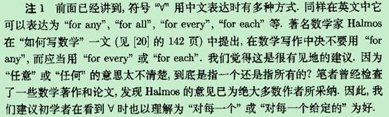
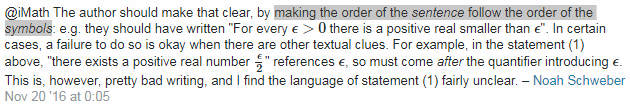

 

写数学论文里不用any或for any，要用

The point is that in everyday English "any" is an ambiguous word;

depending on context it may hint at an existential quantifier ("have you

any wool ?", "if anyone can do it, he can"（译文：如果有人做得到，那么他也能）) or a universal one ("any number

can play"). Conclusion: never use "any" in mathematical writing. Replace

it by "each" or "every", or recast the whole sentence.

摘录自Norman E. Steenrod, Paul R. Halmos, Menahem M. Schiffer, Jean A. Dieudonne-How to write mathematics-American Mathematical Society (1973), page 38

摘录自 谢惠民 - 数学分析习题课讲义 上册，p11

有且仅有 当且仅当

https://math.stackexchange.com/questions/247380/analogy-between-one-and-only-one-and-if-and-only-if

https://en.wikipedia.org/wiki/Uniqueness_quantification

http://mathworld.wolfram.com/ExactlyOne.html

for all and for every , what's wrong with this simple contradiction?

https://math.stackexchange.com/questions/2019638/for-all-and-for-every-whats-wrong-with-this-simple-contradiction

making the order of the sentence follow the order of the symbols

https://groups.google.com/d/msg/sci.math/PxCUK0iXmR0/RUIqgNI_BQAJ

Thanks, you have managed to get my meaning ! 
As you said :

> "Reading in the  natural order, the reader first encounters "there
> exists e/2", but this  is not yet in a context where e has been
> introduced or explained, so  it's encouraging the reader to think this
> is the FIRST choice being  made, not a second (dependent) choice. "

This is the problem on cognition caused by the irrespective of the order of quantifiers on English wording, thus statement (1) is very likely to convey the wrong meaning that "there exists a positive real number smaller than every positive real number", which contradicts with statement (2), this is the contradiction I called in the question.

I will also remember your practical tip on dealing with symbolic formulas and English wording, Thanks again , Mike !

> "The symbolic formulas make absolutely clear the order of 
> quantifications, due to the bracketing etc. but often this would be 
> considered overkill, and English is fine as long as the quantification
> order is made clear.  Often a combination of symbols like Ax: is used
> in  conjunction with less formal English wording, to get something 
> reasonably concise/clear, while still remaining reasonably natural to
> read."

As for reading material, I mainly request it for dealing with the issue caused by the order of quantifiers with English wording, now you solved it !

Yes! 

> "Its an ordering which has an impact to the semantics,  and not an
> ordering which doesn't have any impact at all. "

I think my question was caused by the irrespective of the order of quantifiers on English wording, I requests for reading materials to clear the fog in my mind caused by it. Does your recommendations cover the topic?
I think Mike Terry provided a good answer to my question, also have a look on my reply to him if you have interest . 
Thanks for reply !

Except natural language isn't necciserily clear, just the word "or" introduces natural ambiguity, does "or" include the choice of both options, or just either one? Some go for former, some for latter, etc. 

Thanks for the 'or' example to show the vagueness, imprecision of natural language ! Is there any way to avoid it, especially in mathematics ?

See also: 

The Diversity of Quantifier Prefixes 

H. Jerome Keisler and Wilbur Walkoe, Jr. 

The Journal of Symbolic Logic 

Vol. 38, No. 1 (Mar., 1973), pp. 79-85 

https://www.jstor.org/stable/2271729

https://math.stackexchange.com/questions/2013821/is-it-possible-for-dfrac-1-x-to-be-smaller-than-every-positive-real-numb

