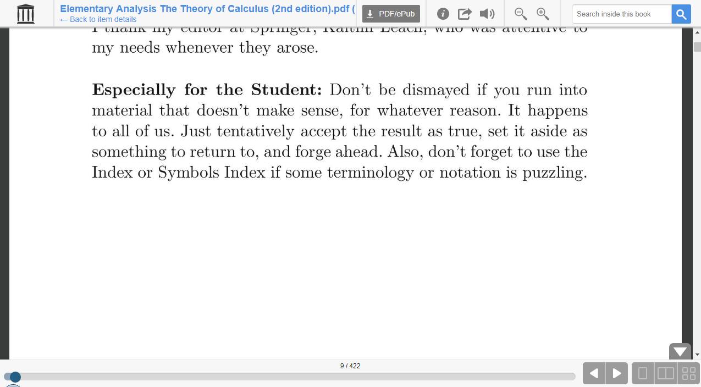
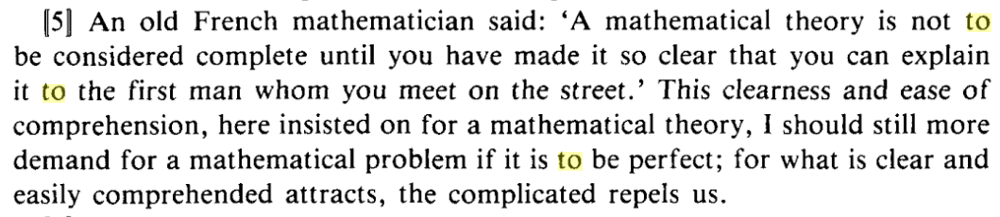

克莱因的书

First, it is too difficult for the students.

Beginners are asked to learn a mass of concepts so subtle that they defied the best mathematicians for

two hundred years. Even Cauchy, the founder of rigor, gave formulations that are crude compared to

what the current rigorous presentations ask students to absorb. And Cauchy, despite his concern for

rigor, missed the distinctions between continuity and differentiability and between convergence and

uniform convergence. Before one can appreciate a precise formulation of a concept or theorem, he

must know what idea is being formulated and what exceptions or pitfalls the wording is trying to

avoid.

https://archive.org/stream/pdfy-_KqLYE14P4NqcS2j/Elementary%20Analysis%20The%20Theory%20of%20Calculus%20%282nd%20edition%29#page/n8/mode/1up

有时候学不好高数不是因为人笨而是因为教材、教师、教学体制的问题，推荐你看看Morris Kline的 Calculus An Intuitive and Physical Approach，看完序言和第一章后相信你会有找到正途的感觉，加油！

