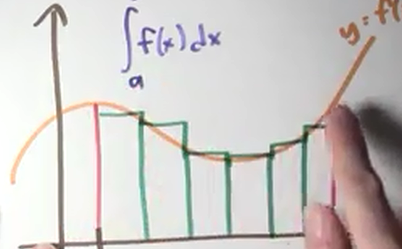

要按照我的理论来计算曲线面积的话，那么就需要0\*（函数在此区间上所有值的和），求这个和还是个问题  
【先换成单位正方形来思考算了】边长为1的正三角形面积为1/2，如果定义+0\*oo=1的话，那么y=x在[0,1]区间上所有值的和就应该是oo/2,这也是有根据得的，因为调和级数的数列变得无穷大，现在问题变成了需要定义发散数列的和的问题了吗？情况是级数的和是由可数个无限大的项的和，而[0,1]区间上所有值的和应该是不可数无限多单位圆的思考  
  
极限式子里的等号并不是真正的等于，而是一种无限逼近的表示方法，所以为了更贴切，我觉得可以使用→代替=，大家觉得如何？  
  
如果+0\*oo=1失败的话，那么请考虑芝诺悖论的解决与不同大小的无限大数  
n→无穷的时候，实际上n趋近于可数无穷大，但最终我是有不可数无穷大多个线段啊，以可数无穷揣测不可数无穷最后竟然得到了正确的值，这是什么情况？？  
  
  
  
