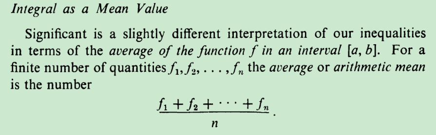
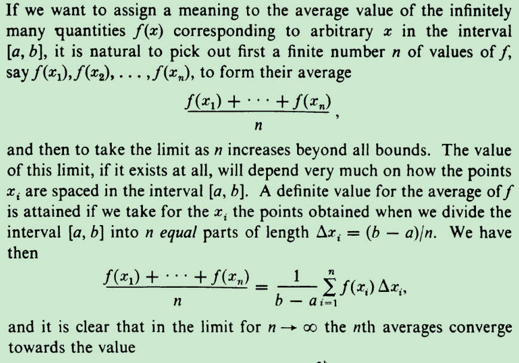
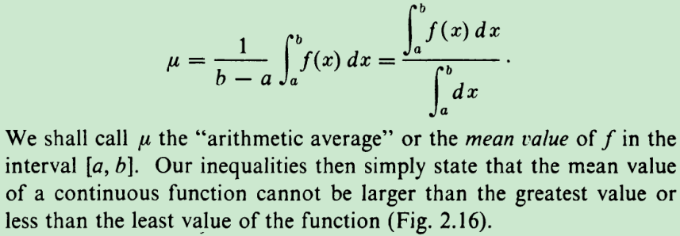
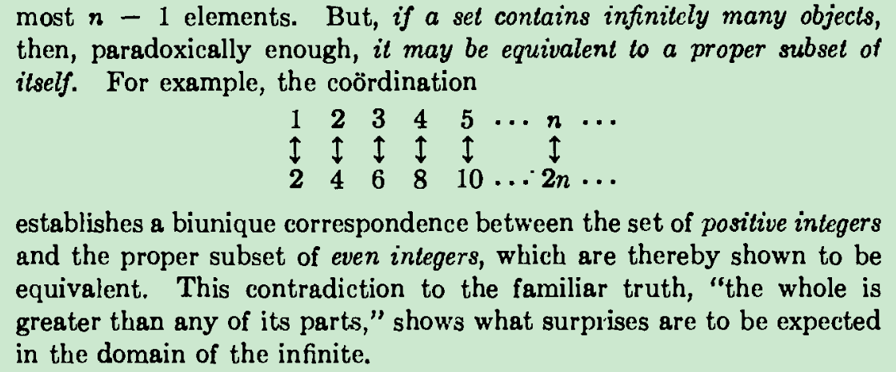
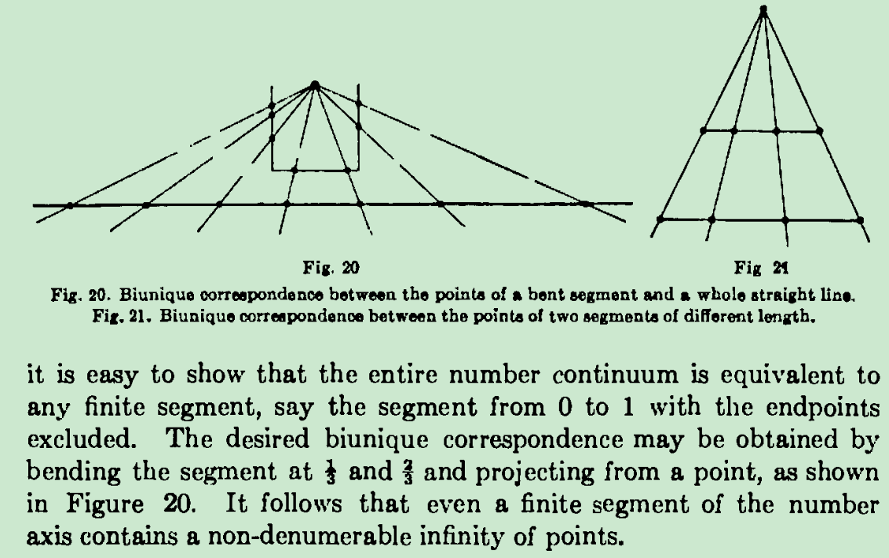
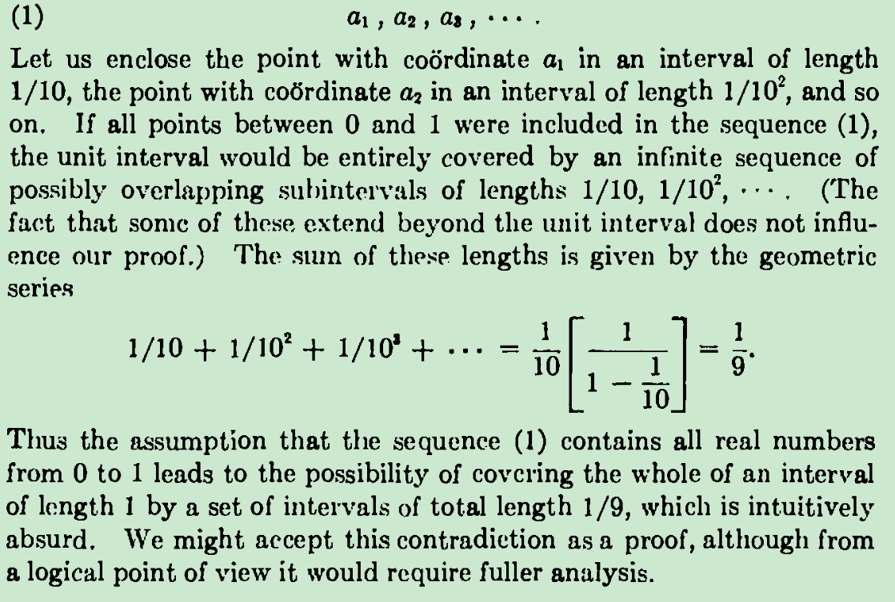
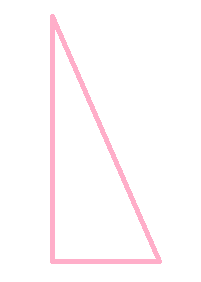
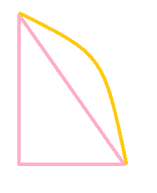
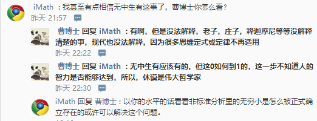

P138

（在此高度为1后就可以变成点的和了---专指后面的sigma的意思）

取区间[0,1]内的点的个数为∞（不认为[0,1]和[0,10]的点数一样多，康托随时变换标准）

那么区间长度1=0*∞≠0+0+0+0+0+……（乘法：多个相同加数相加的和，可数有限个或无限个加数的加法，加数逐个相加的写法已经不适合不可数无限个加数相加了

面对不可数无限个加数，乘法的意义仍然存在，但乘法变加法的意义写法估计行不通了

0+0+0+0+0+……可能=0，0*∞≠0+0+0+0+0+……是为了避免不可数无限个加数面积加得0的情况，因为无穷级数那一套理论估计会出来捣乱

0*3*∞里（长为1、高为3的矩形面积，0*3是每一根高度为3的线段的面积，[0,1]内共有∞根这样的线段），必须先算0*∞，否则出错，一个式子里如果有可能出现0*∞，那么必须先算0*∞，具有更高优先级

上面的资料算出了所有函数值相加的平均值，比如对于一个5*3的矩形，每条竖线的面积是3*0，但是总的加数共有5*∞个，矩形的面积等于所有竖线的面积的和，得出乘法的意义3*0*5*∞=15

不可数无限个点是连续的必要条件   地理克雷函数是反例     [0,1]内的有理点和所有实数点

基于上面这些理论，1/x=0的解是∞，根据1/x图像的对称性，得出（0，∞）和（∞，0）是对称点

问题：3/x=0的解是∞还是3 ∞ or both？   考虑到涉及（1）∞ 的运算的特殊性和（2）出现（0，3∞）和（3∞，0）是对称（3）0和3*0的不同--0的运算，暂且支持解是3 ∞--------------联系之前奋斗了大半年的理论

1/2^n=0,1/3^n=0的解

0的除法定义之后，可以将等比数列前n项和公式合并（剔除q=1的例外情况

什么是数学上面的第一次说明

不同长度的线段的一一对应，投影点的位置随时改变啊~~~~~~~

【0,1】内的数不可数

积出每一点的长度及其积出平均值

区间套定律

实数为什么是连续的

任意两个无理数之间是否都含有一个有理数？

从有限变为无限

[点的求和.docx](attachments/点的求和.docx)

把【0,1】内的可数无限大和不可数无限大组合起来，得到一种组合起来的第三种无限大 （分开单独讨论两种无穷大不如合起来统一处理）  0*∞=1  仍然不死

平面里的长度需要两个维度来衡量，空间里的长度则需要三个维来衡量

如果只看一个维度的话，那么直角三角形的斜边也和直角边一样高了~~

单位长度里减去所有有理点的长度和，无理点的长度和依然为1，为什么？？？

后来我想到并认为正确的是

二维里，x维和y维的点都可以一样（投射在xy轴的点可以一样），但最终和斜边的长度同样可以不一样

 

