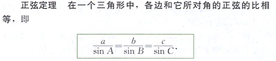
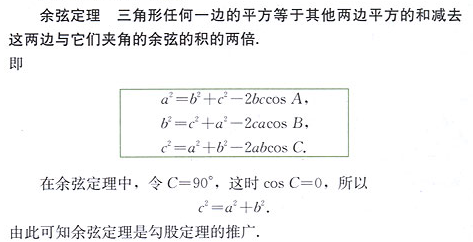

https://wenku.baidu.com/view/75454afa02768e9951e738d4.html?rec_flag=default

常用三角函数、导数、极限

https://wenku.baidu.com/view/91d659ee6294dd88d0d26b0e.html?rec_flag=default里面的公式错了

tan(A - B) = (tan(A) - tan(B))/(1 + tan(A) tan(B))

特殊角的值

https://wenku.baidu.com/view/50b71452f01dc281e53af077.html?fr=income2-doc-search&_wkts_=1693903321286

