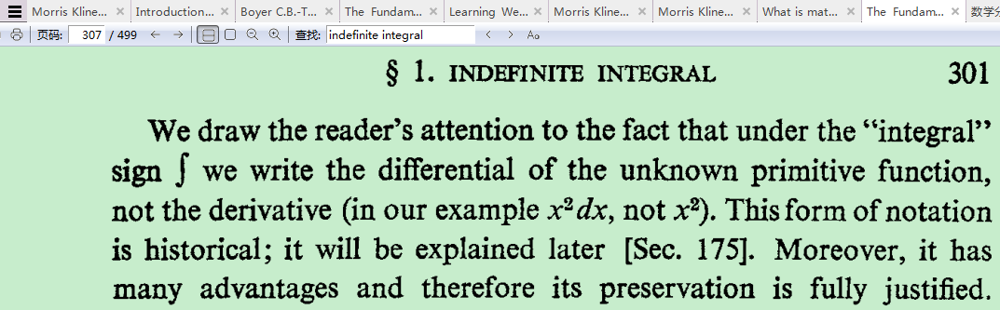
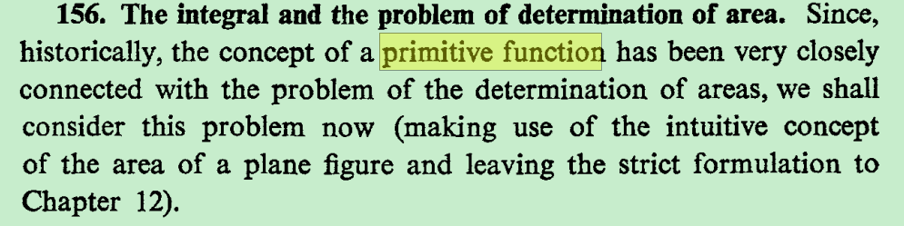
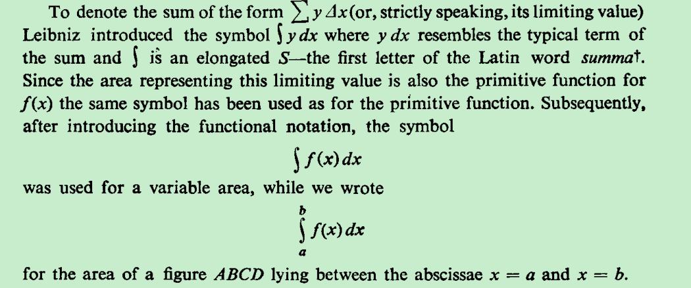
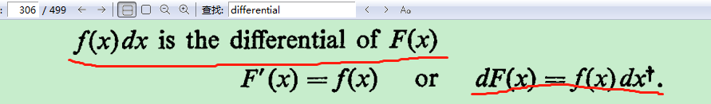
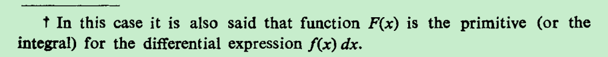
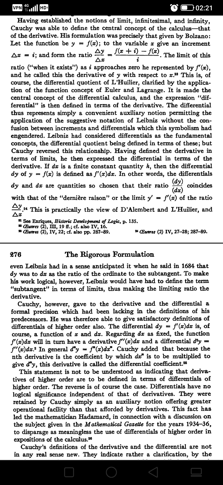
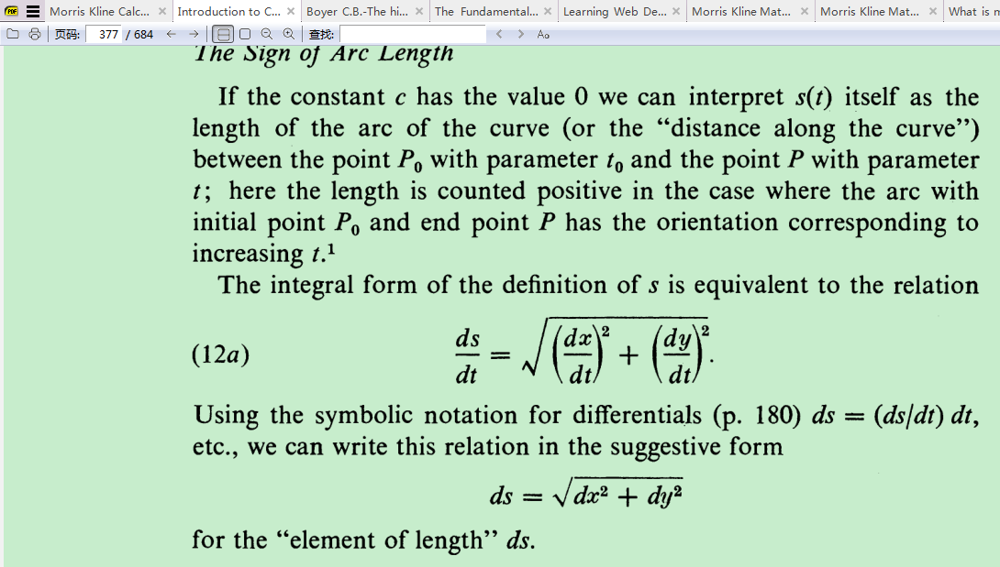

所以要解决这个问题也要探寻微分differential的定义或缘由

目前觉得先不要管符号形式，先把握主要思想（这也是更重要的），在后面学知识的过程中逐步留意这种符号的优势。如果一开始就纠结于这种符号相关的形式问题，那么最终即便是研究清楚了，但是似乎也无关宏旨，最重要的一点是这种符号的优势确实是有必要多学后面的知识才能有所领悟，目前我掌握的知识太少，所以揪着不放研究下去可能会有点浪费时间。慢慢体会——这是目前发现的正道。

为什么把Delta x换成dx？

（1）x是自变量时，dx等同于△x，那我就好奇这种情况下何必多此一举引入dx这个新符号；（2）按照某些教科书上面的说法，∫f(x)dx=F(x)+C仅仅表示f(x)的原函数是一般式为F(x)+C，这让我思考为了表达这种关系dx是否有必要在∫f(x)dx中——难道∫f(x)不足以表达这种意思？（3）有说用∫f(x)dx表示不定积分有一定的优势，说是比牛顿的符号有优势，具体是什么优势，这也是我好奇的，接下来会探究探究

1.我单针对你的第一个思考点说一下我的理解:
（1)不论x是否为自变量时(也即: 不论x是否等于△x)，  我们都有dy= f'( x) dx，所以用dx统一这两种情况。这是非常完美的统一。
（2）dy/dx这个符号在微分出现之前就已经出现了，它被当作一个整体用来表示导数；接着，当我们定义了微分之后，正好发现，在x=a点，y的微分和x的微分之和商为导数，恰恰和dy/ dx这个符号不谋而合。所以，我为什么不将就，就用dy来表示y的微分，用dx来表示x的微分呢。

2.关于第二个第三个问题，温故一遍积分定义，并考虑到后续的二重积分、三重积分，我觉得你很快就会发现原因的，以及这些表达的好处。

---

从数学史（根本）角度来看微分dy和导数dy/dx的关系

https://zhuanlan.zhihu.com/p/267022793

本文选自 Carl B. Boyer, The History of the Calculus and Its Conceptual Development 

Having established the notions of limit, infinitesimal, and infinity, Cauchy was able to define the central concept of the calculus - that of the derivative. His formulation was precisely that given by Bolzano:

Let the function be $y=f(x) ;$ to the variable $x$ give an increment $\Delta x=i ;$ and form the ratio $\frac{\Delta y}{\Delta z}=\frac{f(x+i)-f(x)}{i} .$ The limit of this ratio ("when it exists") as $i$ approaches zero he represented by $f^{\prime}(x)$ and he called this the derivative of $y$ with respect to $x .$ This is, of course, the differential quotient of L'Huilier, clarified by the application of the function concept of Euler and Lagrange. **It is made the central concept of the differential calculus, and the expression "differential" is then defined in terms of the derivative. The differential thus represents simply a convenient auxiliary notion permitting the application of the suggestive notation of Leibniz without the confusion between increments and differentials which this symbolism had engendered. Leibniz had considered differentials as the fundamental concepts, the differential quotient being defined in terms of these; but Cauchy reversed this relationship.** Having defined the derivative in terms of limits, he then expressed the differential in terms of the derivative. If $d x$ is a finite constant qunntity $h,$ then the differential $d y$ of $y=f(x)$ is defined as $f^{\prime}(x) d x .$ In other words, the differentials coincides $d y$ and $d x$ are quantities so chosen that their ratio $\frac{(d x)}{(d x)}$ with that of the "dernière raison" or the limit $y^{\prime}=f^{\prime}(x)$ of the ratio $\frac{\Delta y}{\Delta x} \cdot^{24}$ This is practically the view of $D$ 'Alembert and L'Huilier, and even Leibniz had in a sense anticipated it when he said in 1684 that $d y$ was to $d x$ as the ratio of the ordinate to the subtangent. To make his work logical, however, Leibniz would have had to define the term "subtangent" in terms of limits, thus making the limiting ratio the derivative.

Cauchy, however, gave to the derivative and the differential a formal precision which had been lacking in the definitions of his predecessors. He was therefore able to give satisfactory definitions of differentials of higher order also. The differential $d y=f^{\prime}(x) d x$ is, of course, a function of $x$ and $d x .$ Regarding $d x$ as fixed, the function $f^{\prime}(x) d x$ will in turn have a derivative $f^{\prime \prime}(x) d x$ and a differential $d^{2} y=f^{\prime \prime}(x) d x .^{2}$ In general $d^{n} y=f^{n}(x) d x^{n} .$ Cauchy added that because the nth derivative is the coefficient by which $d x^{n}$ is to be multiplied to give $d^{n} y,$ this derivative is called the differential coefficient.

**This statement is not to be understood as indicating that derivatives of higher order are to be defined in terms of differentials of higher order. The reverse is of course the case. Differentials have no logical significance independent of that of derivatives. They were retained by Cauchy simply as an auxiliary notion offering greater operational facility than that afforded by derivatives.** This fact has led the mathematician Hadamard, in connection with a discussion on the subject given in the Mathematical Gazette for the years 1934-36, to disparage as meaningless the use of differentials of higher order in expositions of the calculus. ${ }^{26}$

不考其源流,莫能通古今之变;不明其得失,无以获从入之途。——清·皮锡瑞

