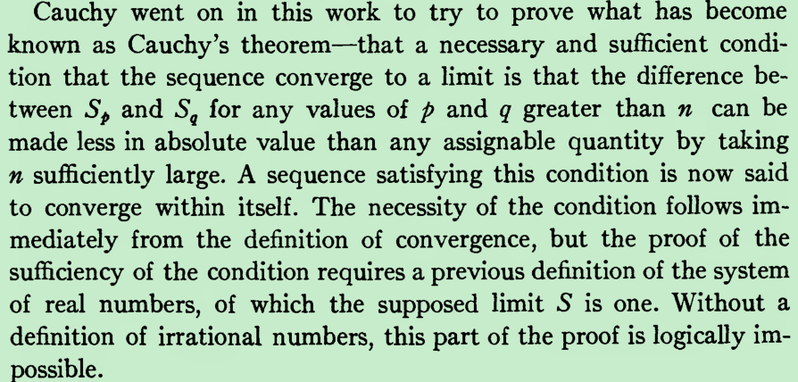
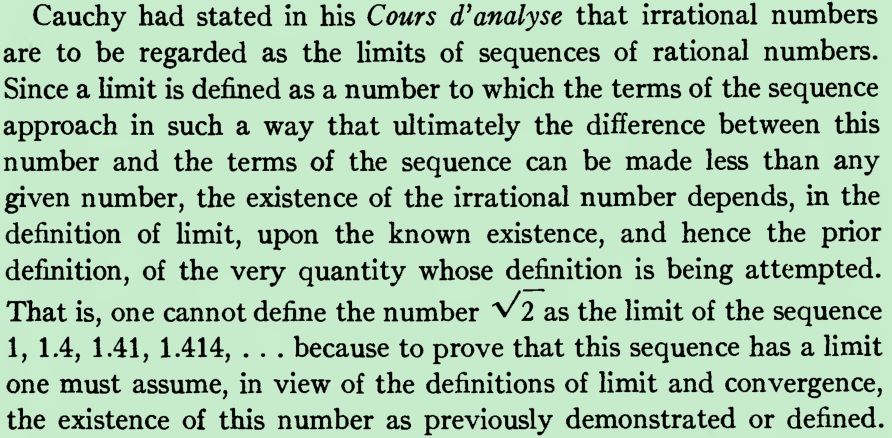
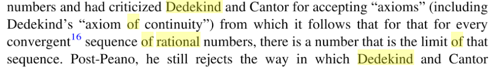
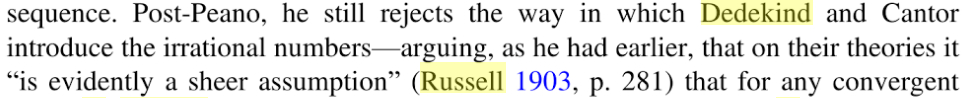
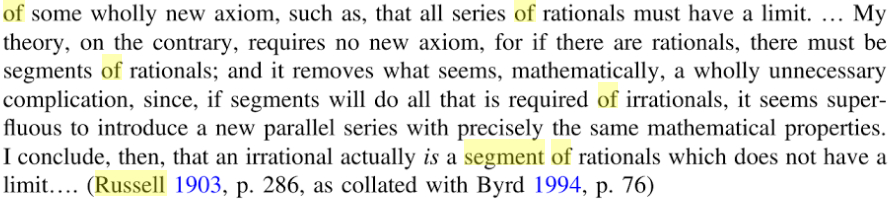

If we consider the sequence of rational numbers, continued in

the obvious manner, 3,3.1,3.14,3.141,3.1415,3.14159,..., we

are well aware that it converges to the irrational number π so

that, if the nth term of the sequence is x n then, using Cauchy’s

rigorous formulation of limit, given any rational ε > 0 there is a

positive integer n so that |x_n − π| < ε. We could think of defining

π as the limit of this sequence, but we have already mentioned

that our argument would be circular: we are using the limit itself

to define the limit itself and we need to know how to define an

irrational number as the limit of an infinite sequence, without

assuming that limit’s existence.

definition of irrational number which should be independent of the limit idea, since the latter presupposes the former.

the definition of irrational numbers and the proof of Cauchy's theorem

search : Cauchy went on in this work to try to prove what has become

known as Cauchy's theorem 

Why the necessity of the condition here doesn't require a previous definition of the system

of real numbers, especially the definition of irrational numbers, but the proof of the

sufficiency of the condition does ?

One cannot define irrational numbers as the limits of sequences of rational numbers.

Apart from Hamilton, Kline [14, Chap. 41] indicates that other pre-Weierstrassian constructions of the period attempted to define the irrational numbers as the limit of a sequence of rational numbers. The problem with this approach is that the limit, if irrational, does not logically exist until the irrational numbers have been defined. Georg Cantor [4] suggests that this error went unnoticed because it did not lead to inconsistencies with the “usual” properties of the real numbers, as understood at the time.

Both Meray and Weierstrass understood the error involved in the circular way that Bolzano and Cauchy had defined the concepts limit and real number:

the limit (of a sequence) was defined to be a real number SS

a real number was defined as a limit (of a sequence of rational numbers)

In other words, since the definition of the former presupposed the notion of the latter, therefore, the definition the latter must be independent of the former! To avoid this circularity, Meray avoided references to convergence to an (external) real number S. Instead, he described convergence using only the rational numbers n, p, and ε, which is the Bolzano-Cauchy condition.

Cantor himself pointed out an error with all these attempts:[89]

the limits of such sequences, if irrational, do not logically exist until the irrational numbers themselves have been defined

P983,

Morris Kline, Mathematical thought from ancient to modern times Volume 3

Apart from this unfinished work all pre-Weierstrassian introductions

of irrationals used the notion that an irrational is the limit of an infinite

sequence of rationals. But the limit, if irrational, does not exist logically

until irrationals are defined. Cantor8 points out that this logical error

escaped notice for some time because the error did not lead to subsequent

difficulties. Weierstrass, in lectures at Berlin beginning in 1859, recognized

the need for and gave a theory of irrational numbers. A publication by

H. Kossak, Die Elemente der Arithmetik (1872), claimed to present this theory

but Weierstrass disowned it.

