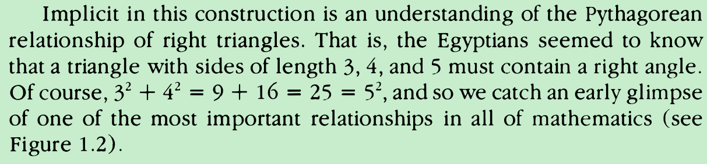

为什么注定是90度？不是别别的度数？为什么注定是直角而不是别的角？

As we shall see, a perfectly true statementmay have a false converse, but in the case of the famous Pythagorean theorem,both the proposition and its converse are valid.
