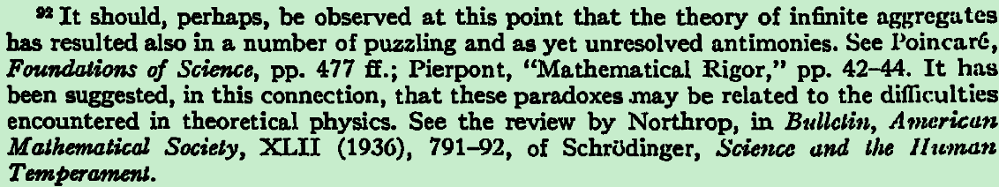

It should, perhaps, be observed at this point that the theory of infinite aggregates

has resulted also in a number of puzzling and as yet unresolved antimonies. See PoincarG,

Foundations of Science（https://file.largepdf.com/file/2019/04/09/9619083145.pdf）, pp. 477 ff.; Pierpont, "Mathematical Rigor," pp. 42-44. It has

been suggested, in this connection, that these paradoxes .may be related to the difficulties

encountered in theoretical physics. See the review by Northrop, in Bulletin, American

Mathematical Society, XLII (1936), 791-92, of SchrOdinger, Sciettce and the Human

Temperament.

