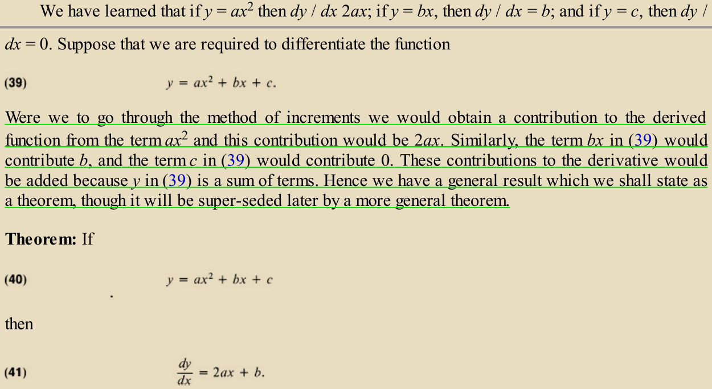
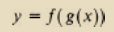
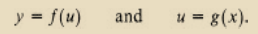
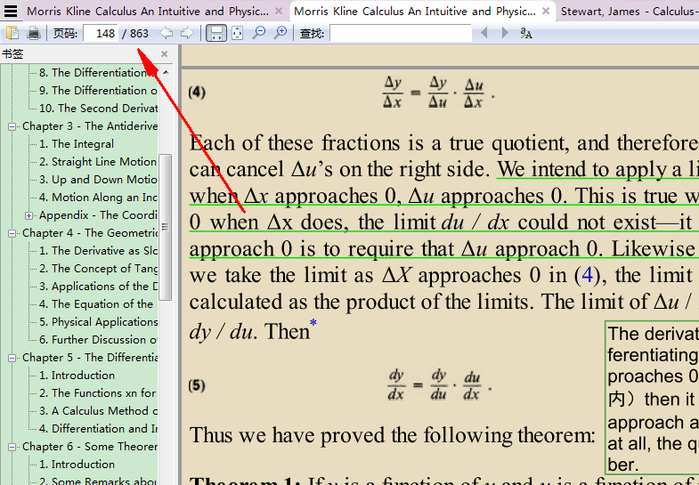

fractional enumeration principle        chain rule

引子

y的变化可以分布来看：x的变化造成了u的变化，u的变化造成了y的变化，这两种变化的变化率都可以知道（题设条件），那么和y的变化率的联系可以通过分步计数原理来探究，分步计数原理最开始是基于整数的，进一步应该可以拓展到有理数（两个概率相乘），再通过Dedekind定义实数乘法的方式应该可以将分步计数原理拓展到实数，那么也就可以用来探明y的变化率和这两种变化的变化率的联系

辅助

