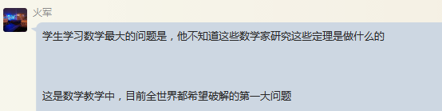
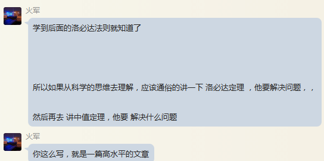
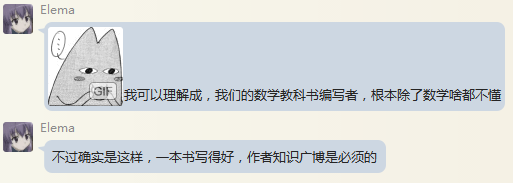

QQ 840773599

微积分的积分的中值定理，就是这样

数学家为什么它，它有什么重要的作用，这是学生特别想知道的事情，或者说学生学习这个定理最爱的难点

---

最近看了，许多被称为世界级的科学 通俗作品，

这些作品的唯一的目的，就是想办法告诉读者 ，数学为什么要研究这个定理

---

我讲一讲对中值定理的认识

求极值，是微积分研究的一个重要目的

一个曲线的极值在哪里？数学家们通过各种工具研究它，其中一个重要工作就是 中值定理

---

---

数学教育的最大问题，就是数学的公理化特点，一般人是搞不明白的， 包括数学老师

---

过分关注数学的证明 ，其实有些跑偏

任何东西都不能过分的关注

数学就是过分关注证明了 ，使它偏离了正确方向

---

---

我们说最伟大的数学家牛顿和莱布尼茨 ，

我们想一想如何，他们两个关注数学证明吧？

过分关关注证明，使你永远不能成为伟大的科学家 ，甚至不可能走不上数学之路

---

你学数学是做什么

 如果是为了考试， 那么最快的方法做题目，套公式，这个非常的直接的，效果是最好的

---

如果你是为了研究科学

 那么，你主要考虑用他怎么解决实际问题， 有可能一不留神就成为了一位伟大的数学家

---

当你把数学当成一个工具的时候 ，你反而容易搞出成果来

历史上，重大数学突破，都是从这方面 入手的

---

总归第一步是学习前人的成果和经验

第二部才是改革完善

你能做到第二步 ，你就是一位科学家了

---

作为年轻人， 许多时候是没有搞清前人的做法和经验 ，就盲目的说前人的做法没有作用 ，这是一个大的错误

---

！其实当你深入去研究一下中国的数学教育， 认真了解一下我们的一些数学家， 华罗庚，林群，等等 他们的经历，你会明白 中国数学为什么落后了

拿他们与钱学森一对比，就明白了

---

我们的钱学森，邓稼先，他们这些人都是学数学的，也学物理的，什么都学的

因为你去搞科研，搞产品 ，你要方方面面都懂的

这就是哲学中的道理， 要全方面的， 全方位了解一个事物 ，而不要片面的，一点式了解一个事物

老百姓话讲，不能盲人摸象，就从一点看一个事物

 华罗庚，林群等等数学中国数学家，数学工作者 ，他们只懂数学的，就是从一点看一个事物， 盲人摸象

---

---

---

---

---

---

---

---

