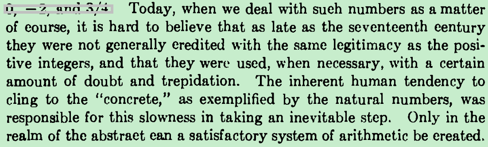

微博-

人类固有本性阻碍数学进步

To foresee the future of mathematics, the true method is

to study its history and its present state. --henri poincare ​​​

从最基础的公理出发，极力避免circular reasoning

The formality of

logic seemed to remove the very life from mathematics.