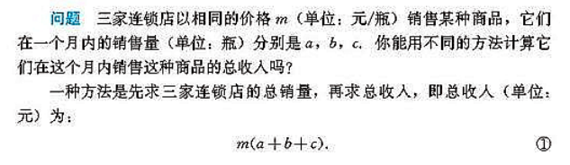
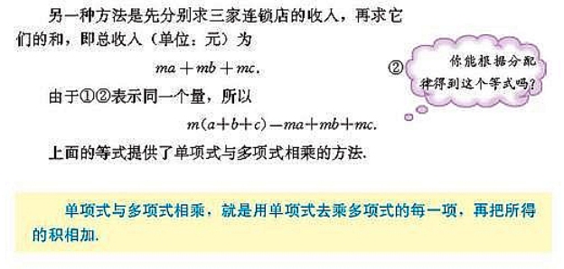

数学大厦从上到下建设，跳跃式的发展，并非循序渐进、步步严谨，严谨化是后期审视数学及其解决数学里的矛盾的产物，严谨化是认知学习以后回顾的结果，按照人类认知行为来，应该先学习概念，再形式化和严谨化，所以初期学习不应该纠结于严谨，而应该学习思想

这是探究分配律得到的启示，如下

第十五章 整式的乘除与因式分解(第140页)

http://www.kebenzhan.com/renjiaoban/banianji/shuxueshangce_2003/#26180

我是通过矩形面积相加减的现象接受这是一条可以普遍适用的规律的

人类最初就是通过这种经验认识总结的规律，信以为真，然后应用并发扬光大，到了后期为了解决数学里存在的矛盾和问题才又回来一丝不苟地检查根基，重新严谨化和formulization的

严谨化之路并非初期认知之路

微积分的严谨化主要还是基础严谨化，而基础严谨化之需求是因为更上层（后面的）的知识要求底层知识严谨化（极限与无理数的例子），所以首次学习如果不明白主干而是从下到上的顺序逐步学习，就会迷茫于零碎的细节（严谨化所致），认识不到学习该知识点的理由，以至于抓不到知识的主干、形不成知识的体系与框架，长此以往的疲惫学习下去甚至丧失了学习的方向与动力，符合学科发展历史与认知规律和历史的方式应该是先掌握主干，掌握大方向后再深入细节

我打算往后面学习了，通过上层的知识来带动底层基础知识的巩固与严谨建设